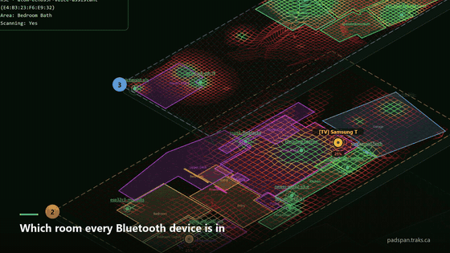
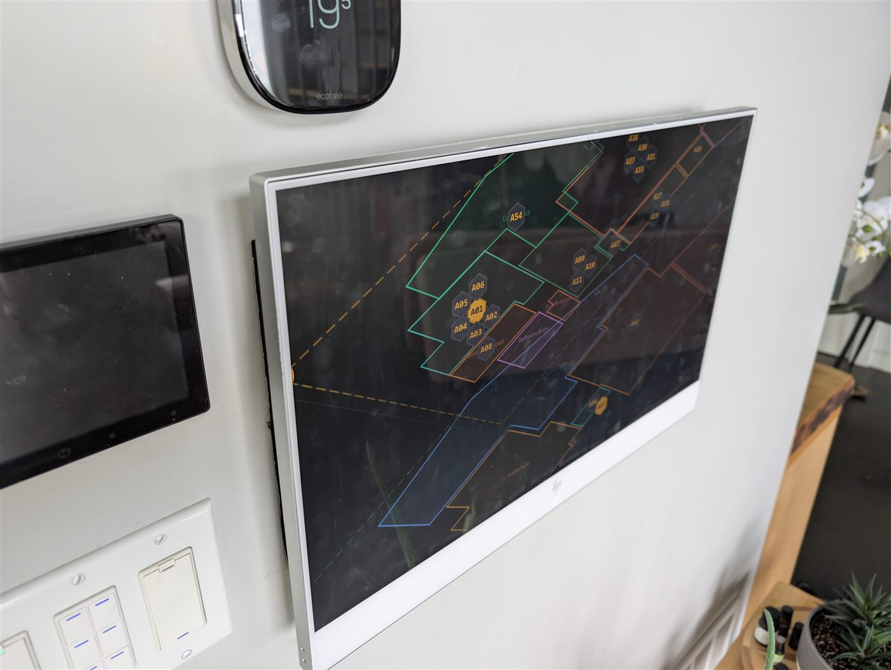

# PadSpan™ HA

### See which room every phone, watch and tag is in, live, on a plan of your home

PadSpan is a Home Assistant integration for Bluetooth room presence. It listens to the Bluetooth proxies you already have, works out which room each phone, watch, tag and beacon is in, every 5 seconds, and shows it on a plan of your home: one floor at a time or all floors stacked. Your automations get room, distance and home/away sensors. Everything runs locally.

▶️ **Try it in your browser: [padspan.traks.ca/demo](https://padspan.traks.ca/demo/)**, the real panel on a sample house. Nothing to install.

 **Install:** one click opens PadSpan in **Settings → Marketplace** (Home Assistant 2026.11 and newer) or in HACS (older versions). Or search either one for PadSpan.

**What you need:** Home Assistant 2024.1 or newer and at least one Bluetooth scanner: an ESPHome Bluetooth proxy, a Shelly Gen2 or newer set as a Bluetooth scanner ([one setting](https://padspan.traks.ca/guides/shelly-bluetooth-proxy/)), your Home Assistant machine's own Bluetooth, or an ESPresense node. One tells you home or away; one in each room you want told apart gives you rooms. [How many proxies do I need?](https://padspan.traks.ca/guides/bluetooth-proxies/) Already running Bermuda? Keep it: [PadSpan runs next to it](https://padspan.traks.ca/guides/bermuda/).

**Free and open source (GPL-3.0).** An optional PadSpan Pro key adds the 3D house (Live Aboard) and a few extra tools ([Editions](#editions)).

🎁 **PadSpan Pro free:** testers get two years of Pro while the anonymous usage report stays on ([how](#become-a-tester-separate-from-the-usage-report)), and until December 31 the first 20 people to ask get a year ([details](https://github.com/gbroeckling/padspanHA/discussions/92)).

🌐 **Website: [padspan.traks.ca](https://padspan.traks.ca)** · 📖 **Guides:** [Why does my phone jump between rooms?](https://padspan.traks.ca/guides/room-flapping/) · [How many Bluetooth proxies do I need?](https://padspan.traks.ca/guides/bluetooth-proxies/) · [Your Shellys can be Bluetooth proxies](https://padspan.traks.ca/guides/shelly-bluetooth-proxy/) · [Your robot vacuum's map as your floor plan](https://padspan.traks.ca/guides/robot-vacuum-floor-plan/) · [Every floor of a big house on one wall](https://padspan.traks.ca/guides/large-homes/) · [Which touch screen for a PadSpan wall?](https://padspan.traks.ca/guides/wall-screens/) · [Bermuda and PadSpan together](https://padspan.traks.ca/guides/bermuda/) · [all guides](https://padspan.traks.ca/guides/) · 🎬 **Making a video or article?** [The creators kit](https://padspan.traks.ca/creators/)

The GIF is a 20-second tour. The same shots at full size are in the table below, and the full walkthrough video is on [padspan.traks.ca](https://padspan.traks.ca/#demo).

---

## Why PadSpan?

Most BLE presence integrations give you a config flow and a sensor. PadSpan gives you a **complete tracking workstation** — floor plan editor, room boundary polygons, 3D isometric maps, walk-around calibration, follow mode with email alerts, a training hub, and a full sample/demo mode so you can explore every feature before plugging in hardware.

It works with your existing BLE scanners. HA Bluetooth proxies (ESPHome, or Shelly Gen2+ set as a Bluetooth scanner) and Bermuda proxies are picked up directly; ESPresense nodes come in over MQTT, which you switch on in **Manage → HA Entities → ESPresense MQTT** and which needs HA's MQTT integration configured. No custom firmware. No cloud dependency. The tracking runs locally.

---

## Screenshots

### Running on the wall

Not a mockup — this is PadSpan on a wall panel in daily use, next to the
thermostat and light switches.

---

| 3D Multi-Floor Tracking | 3D Heatmap + Signal Overlay |
|:-:|:-:|
|  |  |

| Maps Library | Scanner-to-Device Graph |
|:-:|:-:|
|  |  |

| Traceback Playback + Distance Traveled | Beacon Tune Calibration |
|:-:|:-:|
|  |  |

| Live Tracker — Immersive Dashboard | Traceback — Movement Playback |
|:-:|:-:|
|  |  |

| Sandbox Developer Tools | Floor Plan Editor |
|:-:|:-:|
|  |  |

---

## Feature Highlights

### Presence Tracking
- Room-level BLE device tracking (5-second refresh)
- **Follow mode** — animated room map + movement timeline for any tracked device
- Multi-device simultaneous tracking with per-device email alerts (60 s rate limit)
- Kalman-filtered RSSI smoothing (replaces simple moving averages)
- Home/away detection with HA binary sensor entities
- **Phone & watch tracking** — guided setup wizard with [irk-capture](https://github.com/DerekSeaman/irk-capture) integration, HA Companion App iBeacon for Android, and IRK resolution for Apple devices
- Private BLE address resolution (iBeacon UUID + IRK support)
- **Occupancy estimation** — people in the building, never devices: HA person entities (one per phone), unclaimed phones and watches recognised on the air by their rotating addresses and clustered by RSSI co-location, and occupancy/motion sensors by room; tagged things are listed, not counted

### Device Identity
- **Stable device identity (padspan_id)** — every physical device gets an immutable ID that survives MAC rotation, iBeacon UUID changes, and firmware updates
- O(1) identity resolution from any volatile key (MAC, iBeacon, canonical_id)
- Automatic migration from older object/tag systems
- Interactive device registry: merge duplicates, add identities, relabel, delete

### Floor Plans & Maps
- Upload architectural floor plans (PNG/JPG) with auto-scaling
- **Two-point measure tool** for precise real-world scale calibration with aspect ratio validation
- Draw room boundary polygons directly over blueprints
- Multi-floor **3D isometric visualization** with live object positions
- **2D flat map mode** with zoom/pan and toggle filters (scanners, tagged, unknown, rooms)
- Drag-and-place scanner markers with 3-digit radio IDs
- Auto-detect stale or missing radios on your map
- Master map alignment for multi-floor coordinate consistency

### Calibration
- Walk-around fingerprint collection with a **standalone phone-friendly panel**
- k-NN fingerprint matching + OLS path-loss model fitting per scanner
- Coverage heatmap with guided "walk here next" target suggestions
- Leave-one-out cross-validation for model quality scoring
- 3D isometric tune view with draggable receiver markers

### Multi-Floor Intelligence
- **Floor-transition learning** — adaptive dwell-based velocity gate prevents phantom floor changes
- Learned cross-floor RSSI attenuation
- Outdoor penalties (0.30× Gaussian damping) for exterior boundary rooms

### Phone & Watch Tracking

Tracking phones is the hardest problem in BLE presence — they rotate their Bluetooth address every ~15 minutes specifically to prevent tracking. PadSpan offers multiple paths depending on your device:

| Device | Easiest Method | What You Need |
|--------|---------------|---------------|
| **Android phone** | HA Companion App iBeacon | Install app, enable BLE Transmitter. Done. |
| **iPhone / iPad** | IRK via [irk-capture](https://github.com/DerekSeaman/irk-capture) | Spare ESP32, flash irk-capture, pair once, paste IRK |
| **Apple Watch** | IRK via irk-capture | Same as iPhone — pair watch to irk-capture ESP32 |
| **Tile / Chipolo** | Automatic (iBeacon) | Stable UUID — just works, tag once and the name sticks across rotations |
| **AirTag** | Probabilistic (experimental) | Enable **Apple Device Classification** + **MAC Rotation Bridging** in Settings → Features. AirTags rotate both MAC and Find My key every ~15 min and expose no stable identifier, so bridging links rotations by advertisement pattern — works while in continuous range, may mis-link in crowded RF environments |
| **SmartTag** (Samsung) | Probabilistic | Same as AirTag — no stable identifier in the air, relies on MAC Rotation Bridging |
| **AirPods** | Apple auto-classification | Detected and labeled automatically when feature enabled (display only — does not solve identity) |

The **Phone Setup Wizard** (experimental) guides you through each path with step-by-step instructions. If you have an irk-capture ESP32 on your network, PadSpan auto-detects captured IRKs — no manual hex pasting.

For devices where you can't get an IRK, the experimental **MAC Rotation Bridging** feature matches advertisement patterns across address rotations to maintain tracking continuity.

> **Acknowledgement:** The IRK extraction workflow is built on [Derek Seaman's irk-capture](https://github.com/DerekSeaman/irk-capture) — an ingenious ESP32 tool that emulates BLE peripherals to extract Identity Resolving Keys during pairing. It's what makes practical phone tracking in Home Assistant possible without rooting devices or owning a Mac.

### Scanner Hardware & Management
- **Tested with 20+ ESP32 boards** — the antenna matters more than the chip. Boards with full-size external antennas consistently outperform chip/PCB antennas for room-level accuracy
- Top picks: ESP32-S3 with Ethernet + antenna, ESP32-S3 with WiFi + antenna, ESP32-C3 with antenna
- Auto-discover BLE scanners from Home Assistant integrations
- Per-scanner signal quality metrics and coverage analysis
- WiFi SSID, IP address, and connection type display
- Assign scanners to floors and rooms on the map

### Alerts & Automation
- Email alerts on room change (per device, 60-second rate limit)
- HA entities: **area sensors**, **distance sensors**, **device trackers**, **binary sensors**
- Full WebSocket API for custom dashboards and automation

### Analytics
- **Insights** (a Traceback mode) — per-object time-in-room and entry-count tables, plus peak concurrent occupancy, with CSV/JSON export
- **Busy Times** (a Traceback mode, PadSpan Pro) — which rooms are busiest overall and by hour of day, aggregated across every tracked object over a 1/3/7-day range
- **Locate** (a Follow option, PadSpan Pro) — room-by-room wayfinding to the device or person you're following, from wherever your own tracked phone currently is; a live metre-distance readout once you're in the same room. No compass, no camera — routed over your own room-adjacency map, refreshed on every live poll like Follow

### Atlas — The Device Map
Formerly "Lights" — renamed because it outgrew the name. One isometric map of every floor, drawn the way an electrician draws a lighting plan, for placing and controlling real devices rather than just tracking BLE:
- **Fixtures** — lights, fans, locks, and motion, temperature, humidity, air-quality and flood sensors, each placed at their real position, shape, size and rotation
- **WLED control** — brightness, colour and effects live from the map
- **Outdoor gear** — anything HA puts on an Outside floor (shed, garden, driveway) places on the real floor plate just outside the room it lives beside, instead of falling off the map
- **Doors & windows** as real RF barriers — material-aware attenuation (steel blocks harder than hollow-core), live open/closed state, and an **Invert** toggle for a sensor that reports backwards
- **Automorph** — a soft aura grown from a fixture into its room, in a growing set of distinct styles (Glow, Blueprint, Nebula, Halo, Bloom and more)
- **Showcase** — 19 curated visual themes for the map itself, with a presets bar to save and load a look
- A **hover HUD** names what's under the cursor (or a touch hold) with every stacked marker as a clickable row; **Alt+click** cycles the stack when several devices sit on top of each other
- Full touch support — pinch-zoom, drag and tap are tuned for a wall panel or phone, not just a mouse

See the [Atlas Guide](./docs/ATLAS_GUIDE.md) for a full walkthrough, and the [Live Aboard Guide](./docs/LIVE_ABOARD_GUIDE.md) for the 3D house (Pro). Placement, Automorph and Showcase are PadSpan Pro (or [PadSpan Bright Pro](https://github.com/gbroeckling/padspanBright)) features — see [Editions](#editions) below; a free install still gets floors, rooms and a tap-to-toggle marker per light.

### UI & Experience
- **Live Tracker mode** — immersive full-screen 3D dashboard with pan/zoom, floating glass overlays, and collapsible info panels
- **22 dedicated views** with Basic and Advanced modes
- **5-step onboarding wizard** with auto-detection and progress tracking
- Dark forest-green theme designed for always-on displays
- Built-in **Training Hub** with 16 animated walkthroughs + full manual
- **Sample mode** — fully functional demo with synthetic data, no hardware needed
- Standalone calibration panel optimized for phone use during walk-around collection
- **NVR-style movement playback** — replay tracked device movement on the 3D map

### Experimental Features (Settings → Features)
- **Phone Setup Wizard** — guided flow for tracking phones and watches. Auto-detects [irk-capture](https://github.com/DerekSeaman/irk-capture) ESP32 devices on your network and walks through IRK extraction step by step. Also shows the easy Android path (HA Companion App iBeacon) and Apple IRK options. Credit to [Derek Seaman](https://github.com/DerekSeaman) for the excellent irk-capture tool that makes IRK extraction practical for everyone.
- **MAC Rotation Bridging** — when a phone's Bluetooth address rotates (every ~15 min), PadSpan matches advertisement characteristics (company ID, services, signal pattern) to tentatively link old and new addresses. Bridges the tracking gap without requiring an IRK. Probabilistic — may occasionally link wrong devices.
- **Apple Device Classification** — shows what sent an Apple Find My signal (AirTag, another brand's Find My tag, AirPods, or an Apple device such as an iPhone, iPad or Mac) instead of just "Find My", in Objects, Bluetooth → Advertisements and a device's details. It can't tell an iPhone from an iPad or a Watch: nothing Apple sends over Bluetooth says which. Display-only — does not affect tracking or identity.
- **Radio Map** — RSSI heatmap overlay using inverse distance weighting
- **Signal distortion map** — where positions matched to calibration points (k-NN) disagree with reality
- **Trackability Rating** — per-device Easy/Medium/Hard scoring
- **Walk-to-Identify** — discover unknown devices by correlating walking motion
- **Compass Ring Calibration** — structured 360° RSSI collection
- **Replay Timeline** — enhanced playback with scoring explainability

---

## How It Compares

[Bermuda](https://github.com/agittins/bermuda) and [ESPresense](https://espresense.com/) are both good, and lots of people run them. This is what each does, from their own docs as of October 2026 ([more detail](https://padspan.traks.ca/guides/bermuda-vs-espresense/)). If something here is out of date, [open an issue](https://github.com/gbroeckling/padspanHA/issues) and it gets fixed.

| | PadSpan HA | Bermuda | ESPresense (+ Companion) |
|:--|:--|:--|:--|
| Room-level presence | ✅ | ✅ | ✅ |
| Hardware | ESPHome Bluetooth proxies, Shelly Gen2+, HA's own Bluetooth or a USB adapter, or ESPresense over MQTT once switched on | ESPHome Bluetooth proxies, Shelly Gen2+, USB adapters | Its own firmware on ESP32 nodes |
| Floor plan needed? | No: rooms come from each scanner's HA area; the map is optional | No | No for rooms; Companion's map needs your rooms as coordinates (YAML, or made with MagicPlan or its Floorplan Creator) |
| Map of your home | ✅ draw rooms on your floor plan | — | ✅ Companion |
| Multi-floor 3D view | ✅ (the full 3D house, Live Aboard, is Pro) | — (has a Floor sensor) | ✅ Companion |
| Position between scanners | ✅ with 3+ scanners placed on a measured plan | — | ✅ Companion (X/Y/Z) |
| Calibration | Walk-around fingerprints and per-scanner signal fit | Guided: global, per proxy and per device | Manual on each node; automatic in Companion |
| Signal smoothing | Kalman filter plus a room vote | Averaging, a speed limit on moving away, and area hysteresis | Filtering on the node, Kalman on position (Companion) |
| iPhones and Apple Watches (IRK) | ✅ via Private BLE Device or irk-capture, with a setup guide | ✅ via Private BLE Device | ✅ enrolled on the node's web page |
| Tags that change address (AirTag, SmartTag) | Experimental | — | — (AirTags can only be counted) |
| HA room, distance and tracker entities | ✅ | ✅ | A room sensor with distance; a tracker from Companion |
| Movement history | ✅ playback (Traceback) | HA's own history, no playback | Path view in Companion (its history logging is in beta) |
| Alerts when a device changes room | ✅ built in (Follow) | With your own HA automations | With your own HA automations |
| Where you set it up | A PadSpan panel in the HA sidebar | Home Assistant's setup dialogs | The node's web page and the Companion app |
| Try it before installing | ✅ [browser demo](https://padspan.traks.ca/demo/) and a sample house | — | — |

Room Assistant isn't in the table: its last release was in March 2022.

Already running Bermuda? Keep it: PadSpan runs next to it on the same proxies and leaves it as it is. [Bermuda and PadSpan together](https://padspan.traks.ca/guides/bermuda/) explains how.

---

## Editions

Everything on this page is **PadSpan HA** — free, GPL v3, no key required.
A licence key unlocks the rest on the *same install*: nothing to reinstall,
nothing to reconfigure.

| Edition | Key | What it is |
|---------|:---:|------------|
| **PadSpan HA** | none | Everything above, free forever. |
| **PadSpan Pro** | `pro` | Every gated feature in PadSpan HA — Atlas device placement (shape, size, angle, WLED, Automorph, Showcase), Forensics, Busy Times, Locate, and anything gated later. |
| [**PadSpan Bright**](https://github.com/gbroeckling/padspanBright) | none | A separate, lighter HACS listing generated from this same source — just the Atlas device map, for anyone who wants light control without the BLE presence tracking. |
| **PadSpan Bright Pro** | `bright` | Bright's full Atlas toolset (placement, shapes, WLED, Automorph, Showcase), priced separately from PadSpan Pro. |

No key yet? **Settings → Features → PadSpan licence** has a one-time 90-day free trial — no card required, no reinstall; it needs the opt-in usage report on, and the report stays on until the trial ends. A PadSpan Pro key also unlocks Bright's tools if you install Bright instead — one key, either download. Pricing and purchase: [padspan.traks.ca](https://padspan.traks.ca).

---

## Installation

The button opens PadSpan in the Marketplace on Home Assistant 2026.11 and newer, and in HACS on older versions.

### From the Marketplace (Home Assistant 2026.11 and newer)

1. Open **Settings → Marketplace** and search for **PadSpan**
2. Open **PadSpan HA** and choose **Install**. The first time, the Marketplace asks you to confirm that what it lists isn't reviewed by the Home Assistant project
3. The setup dialog opens right away, with no restart. Choose **Submit**
4. Open **PadSpan HA** in the sidebar

### Via HACS (Home Assistant 2026.10 and older)

1. Open HACS in your Home Assistant instance
2. Search for and install **PadSpan HA** (it's in the HACS default list, no custom repository needed)
3. **Restart Home Assistant completely** (Settings → System → Restart)
4. Add the integration: Settings → Devices & Services → Add Integration → PadSpan HA

Setting up HACS for the first time? A GitHub change can make HACS's sign-in step fail for now, see [the note in Getting Started](./docs/GETTING_STARTED.md#via-hacs-recommended).

### Manual

1. Download the [latest release](https://github.com/gbroeckling/padspanHA/releases/latest)
2. Extract `custom_components/padspan_ha/` into your HA `custom_components/` directory
3. Restart Home Assistant
4. Add the integration: Settings → Devices & Services → Add Integration → PadSpan HA

---

## Requirements

- Home Assistant **2024.1** or newer
- A machine with **more than 2 GB of RAM** is recommended (a Raspberry Pi 4 or 5 with 4 GB or more, or similar). Near a busy street PadSpan hears thousands of passing devices, and on a 2 GB Pi Home Assistant can run out of memory within hours. See [Minimum requirements](./docs/MINIMUM_REQUIREMENTS.md)
- At least one BLE scanner: an HA Bluetooth proxy, a Bermuda proxy, or ESPresense nodes (ESPresense also needs HA's MQTT integration, and the ingestion switched on in Manage)
- The Marketplace (built into Home Assistant from 2026.11) or HACS, for easy installation and updates

---

## Quick Start

1. Install from the Marketplace (or with HACS, then restart HA)
2. Add the PadSpan HA integration
3. Open the **PadSpan HA** panel in the sidebar
4. The **onboarding wizard** guides you through 5 steps: upload a map, set scale, draw rooms, place scanners, calibrate
5. Try **Sample mode** (top-right toggle) to explore every feature with demo data
6. Switch to **Live mode** when ready — your BLE scanners are auto-discovered
7. Tag your devices, upload a floor plan, and start tracking

---

## Documentation

| Guide | Description |
|-------|-------------|
| [Getting Started](./docs/GETTING_STARTED.md) | First 30 minutes: install, explore, track |
| [Floor Plan Setup](./docs/FLOOR_PLAN_SETUP.md) | Upload, draw rooms, place scanners, set scale |
| [Atlas Guide](./docs/ATLAS_GUIDE.md) | The device map: placing fixtures, doors/locks/sensors, heights, room scenes, Automorph, Showcase, the emergency lighting test, WLED Advanced and Exact look, and openers/locks/lights from relays |
| [Live Aboard Guide](./docs/LIVE_ABOARD_GUIDE.md) | The Atlas in 3D: getting around, motion, the heat map, scenes, and building doors, windows, heights and strips |
| [Walls Guide](./docs/WALLS_GUIDE.md) | Wall materials and signal loss: where the numbers come from, real-world ranges, old buildings, and setting your own |
| [Furnish Guide](./docs/FURNISH_GUIDE.md) | Furniture, devices and people in the 3D house: builders, from a photo, the shared library, Sweet Home 3D import |
| [Wall Screen Guide](./docs/WALL_SCREEN_GUIDE.md) | PadSpan on a tablet or wall screen: kiosk links, full screen, going back home by itself |
| [PadSpan Pro](./docs/PADSPAN_PRO.md) | The 90-day trial, entering a key, getting Pro free as a tester, and invites |
| [Troubleshooting](./docs/90_TROUBLESHOOTING.md) | Common issues and fixes |
| [Architecture](./docs/00_REPO_LOGIC_OVERVIEW.md) | High-level codebase architecture |
| [WebSocket API](./docs/02_WEBSOCKET_API.md) | API reference for custom integrations |
| [Changelog](./CHANGELOG.md) | Full version history |

The **Training Hub** inside PadSpan has 16 animated walkthroughs covering every feature — from BLE basics to Private BLE/IRK setup.

---

## Development

PadSpan HA is built by [Garry Broeckling](https://github.com/gbroeckling) — a 30+ year veteran of coding and scripting who has never claimed to be a fast typist. All architecture, product decisions, testing, and releases are human-directed. Implementation is AI-assisted using [Claude](https://claude.ai) by Anthropic, which accelerates the write–test–ship cycle considerably. Think of it as one developer with strong opinions and a very patient pair-programming partner.

The result: a solo project that ships features at a pace that would normally require a team — without compromising on quality, security, or code review.

How changes are tested and released: [How PadSpan is built and checked](./docs/HOW_PADSPAN_IS_BUILT.md).

---

## What PadSpan never touches

PadSpan reads your other integrations and leaves them as they are. Installing, disabling, reloading or removing it doesn't change another integration's devices, entities or config entries (Private BLE Device, Bermuda, ESPresense, the Companion App or any other). A repo test fails if new code tries to. One thing is Home Assistant's own doing: before Home Assistant 2026.8, it filed PadSpan's sensors under another integration's device with the same Bluetooth address. PadSpan 0.38.162 no longer lets that happen, but a device merged that way before stays merged.

- **Reads:** HA areas and floors, the device and entity registries, Bluetooth advertisements, entity states, and Private BLE Device / Companion App entries (only to name a phone's rotating address).
- **Creates:** its own config entry, its own `padspan_ha` entities and devices, and its own `.storage/padspan_ha.*` files.
- **Never changes on its own:** anything belonging to another integration. The only exceptions are buttons you press, one at a time: Add IRK / Delete from HA (Private BLE), Manage → Delete an entity or area, assigning a radio or light to a room, and Enable & Track for a phone's BLE Transmitter.
- **Uninstalling removes:** PadSpan's own entities and devices, and gives WLED lights their sync back. Its `.storage` files stay (Manage → Factory Reset clears your setup from them first). An IRK you added stays in Private BLE Device.

Details: [What PadSpan never touches](./docs/GETTING_STARTED.md#what-padspan-never-touches).

---

## Security

Names from devices, scanners and rooms are always shown as plain text in the panel. Backups, restores, factory reset, IRKs, map uploads and anything that sends data out of the house need a Home Assistant administrator. For homes where other people have accounts, **Settings → Presence → Enhanced security** (off by default, admin-only) makes every change to PadSpan's shared setup need an administrator as well, while the household can still view and use PadSpan. See [Who can change what](./docs/GETTING_STARTED.md#who-can-change-what) and [SECURITY.md](./SECURITY.md) to report an issue.

---

## Updates & Privacy

Once a day, PadSpan asks `padspan.traks.ca` whether a newer version is available and shows a Home Assistant notification when one is. The request contains **only your installed version number** (e.g. `?v=0.21.10`). Like any web request, the server sees your IP address; nothing else is sent, no identifiers are stored on your system, and no usage data is collected. The aggregate ping count is the only signal the project gets about how many installs exist.

The answer can also switch PadSpan's free-Pro offers (becoming a tester, and invites) off or back on, so an offer that has ended disappears from the panel without an update. It only ever carries those two on/off switches; it cannot add anything to the panel. While the tester offer is on and no licence key is entered, the update notification has one line about it.

To turn it off: **Settings → Presence → Update Check → Disabled**. That stops the version check.

If a licence key is entered (a trial or a purchase), PadSpan also checks it once a day with `traks.ca`, whether or not Update Check is on. That request sends the key and Home Assistant's instance ID, so a refunded or revoked key stops working. Since 0.38.160 it also sends what tells one licence's homes apart: this home's current token (a random code the licence server gave it), the PadSpan version, the name you gave this home (if any), and whether this home's usage report is on. With no key entered, there is no licence check. The usage report below is sent only if you opt in.

**Device makers.** Opening the Objects list asks two public lookup services, macvendors.com and maclookup.app, which company made each nearby Bluetooth device. It sends only the first three bytes of an address, and only after a Bluetooth receiver has confirmed that the device has a fixed, maker-assigned address (ESPHome proxies on version 2022.12 or newer and Home Assistant's own Bluetooth say so, and PadSpan remembers it; Shelly, ESPresense and Tasmota don't, so a device only they have heard isn't looked up). A fixed address never becomes random, so PadSpan keeps the confirmation across restarts, until a Factory Reset. Any other device shows the answer already kept for its first three bytes, if there is one, or says "random address" or "maker unknown (receiver doesn't say)". Each answer is kept for 30 days, so each maker is asked about once. Like any web request, the services see your IP address. It's on by default, and only an administrator can turn it off: **Settings → Tracking → Privacy, updates and feedback → Look up device makers online**, or the switch at the top of the Objects list. Earlier versions sent the whole address.

### Help improve PadSpan (opt-in usage report)

PadSpan is developed against one house. Features that only exist in yours — an iPhone with an IRK, a Bermuda install, twelve floors, a lighting-only setup — never get seen unless someone shares that they exist. So there is an **opt-in, off-by-default** usage report: **Settings → Presence → Help improve PadSpan**. The panel asks for it **once** — in the setup checklist on a new install, or as a card on Overview for an install that finished setup before the switch existed — with the Preview right there; either answer ends the asking, and the switch stays in Settings either way.

When you opt in, at most once a day PadSpan POSTs a small JSON report (a few KB, hard cap 8 KB) to `padspan.traks.ca` containing **counts, versions and flags only** — the complete list:

- `schema`, `version`, `edition`, `tier`, `ha_version`, `python`, the UTC `day`, and the random `install_id`
- `licence_group`: only with a licence key used on more than two homes, 16 hex characters made from the key (never the key itself), the same in each home of that licence, so one licence's homes are seen together. A licence's first two homes always count; with more than two homes, every home must keep its report on, and if one turns it off, the key drops back to its first two homes after 14 days
- `country` and `language`: the two-letter country code and the language tag (such as `en-GB`) set in Home Assistant under Settings → System → General, left out when blank. Never looked up from your IP address
- `env`: how many scanners (and how many with diagnostics / ESPresense / other; how many lost, disabled or excluded), floors, rooms, placed lights (and placed devices by kind: lights, fans, locks, motion, door, leak, smoke/gas/CO alarm, temperature, humidity and air-quality sensors, other), walls, maps, positioned scanners and beacons, calibration points (and how many were automatic, and how many have no floor), how many floors carry a real storey height, how many rooms are given their own height (taller than their floor) and, only from a house with a split level, how many rooms are raised above or sunk below the rest of their floor (counts, never which rooms or by how much), and how many scanners carry a mounting height, IRKs, followed devices, Apple Find My addresses on the air right now by type (AirTag / Find My accessory / AirPods / Apple device) and how many of those are away from their owner, with MAC Rotation Bridging on, the Find My tags PadSpan follows by type (how many are on the air, how many have been carried to a new address), objects (total, identified, and by kind), and how many config entries of each related integration (private_ble_device, bermuda, esphome, mqtt, bluetooth, mobile_app, ibeacon, espresense); the two settings that size the object list (how many days an unidentified object stays in the history, and the oldest advert the live snapshot takes); and `hw`, the class of machine: how many CPUs, total RAM as a bucket (up to 1 / 2 / 4 / 8 / 16 GB, or more), the CPU architecture (x86_64 / aarch64 / armv7 ...), the installation type (OS / Supervised / Container / Core) and the board family (Raspberry Pi 2–5, Home Assistant Green or Yellow, ODROID, Tinker, Khadas, a VM, generic x86-64 or aarch64) — each from a fixed list, anything else reported as `other` or `unknown`; never a model string, hostname or serial; and `temp_fresh`, for the temperature and humidity sensors placed on the map: how many there are, how many reported within the hour by each of Home Assistant's three clocks (last changed, last updated, last reported), how many carry a last-reported time at all, and how long ago they last reported, in fixed buckets (under 5 minutes, 5–15, 15–60 minutes, 1–6 hours, over 6) — counts only, never a sensor, a room or a reading; and, only from a house with quiet mode on, `quiet_hidden`: roughly what share of the objects quiet mode hides (under 25%, 25–50%, 50–75%, over 75%); and, only from a house with two screens or more, a short list of words for each of its first five screens (what its Overview drew, kiosk / full screen / windowed, its resolution class and kind of device), never an id
- `features`: which feature switches are on (including whether the 3D house, Live Aboard, is on, and whether low-memory mode is on), plus `data_mode`, `cpu_mode`, `lights_automorph_style` and the panel's theme (`day_theme`, `light_theme` and `theme_palette`), and, for each Overview screen, only the settings changed from their defaults, as words, never numbers or names (`ov_house`: the floor gap, side offset and one-floor focus, shared with the Atlas's floor stack, and trails; `ov_atlas`: zoom, classic layout, emergency button off, outdoor weather off or its strength; `ov_3d`, only with the 3D house on: quality, people, tags, furniture library, weather off, its own look). A screen on its defaults sends nothing
- `usage`: how many times each tab, sub-tab and tool was used since the last report — which screen the Overview tab actually drew (the house, its empty frame, a floor-plan picture, the room grid, the flat map, the Atlas or the 3D Atlas, and Basic mode), lights and walls placed/removed, rooms committed, IRKs added or refused, calibration points added, captures started, forensics queries, Showcase turned on, backups created/restored, factory resets, Bright imports, how many rotating addresses were newly resolved by an IRK (and how many matched no key), how Find My tags' address changes went (followed, and how many took over 2 minutes; not followed because it was too close to call, because the new address came a little late, because the only new address was somewhere else, or because none appeared at all — the tag left range; a wrong link undone by itself, and how many links, or by a person's **Unlink**; a tag back on its day key), and how many uncaught panel errors came from PadSpan's own code, by the PadSpan file that threw and the tab that was open (the names only — never the message, the stack or a URL; errors from Home Assistant or other cards are not counted), and, from each panel on a screen, its frame rate once a minute and (in Chromium-based browsers) its JavaScript memory, in fixed buckets by the kind of view showing (the Atlas, the 3D house, anything else), and once per page load the class of device it runs on (the browser's own coarse memory figure, CPU threads in a bucket, whether WebGL 2 exists, whether it has touch, and whether Home Assistant's sensor states reach it with their last report time) — never a device model, a browser string or a GPU name; and, once per page load, whether the 3D house (Live Aboard) opened, or could not and showed the flat Atlas instead (no WebGL, too slow, lost graphics, an error), and whether its window-open-in-the-rain alert showed; and, once per page load from the main panel and the sidebar Atlas, what kind of screen it is (opened with `?kiosk=1`, filling the screen untouched for two minutes or in use, or an ordinary window), whether a wall screen that reloaded itself after an update came back on the new version or the old one, and whether a `?view=` link stayed on its view or went back to the menu — never the link or the screen's size; and what the Atlas's outdoor weather did, once per page load (it failed and drew nothing, by kind; it showed light or heavy rain or snow, or showed it still; what decided it — the rain sensor, the weather entity, or which weather-warning service; and what it set aside: a wet rain sensor under a clear sky, taken for dew, or a water-leak detector picked as the warnings sensor — never an entity or a warning's text) — from a closed vocabulary (`telemetry.EVENTS`, the panel's view ids, the Bluetooth/Mapping sub-tab ids, `telemetry.UI_ERRORS`, `telemetry.WEATHER_EVENTS`, `telemetry.CLIENT_EVENTS` and `telemetry.SCREEN_EVENTS`); anything else is dropped Also counted: the free-Pro cards (an invite shown on Overview or in Settings, put off, claimed, refused or declined; the "test it, get Pro free" card shown and its No thanks), Beacon Tune saves (saved, refused because the map isn't placed in metres, failed), records removed by Lost & Found's one-time cleanup, Export for support builds, tagged devices arriving and leaving, Follow alerts sent or failed, Follow's Test sent or failed, the phone wizard's BLE Transmitter command (sent, no phone service found, failed), failed MQTT publishes, IRK cache clears because the keys changed, automatic calibration points that left out their pin's room because it is not a room, restores that merged Lost & Found (and how many records were kept because the one on this install was newer), old Bermuda objects removed from the object history, how many times a Bluetooth proxy started hearing far fewer advertisements than usual (as 1, 2–5 or more), and, once, for an install set up on 0.38.165 or later, how long it took from setup to its first device in a room and to its first calibration point (under 15 minutes, 1 hour, 6 hours, 1 day, 7 days, or longer) — counts only, never which device.
- `health`: crypto present, BLE callback alive, BLE feed diagnostics ok, rotating addresses seen / resolved right now, how many registered IRKs resolved anything since the last report, resolver error count, objects currently attributed outside, coverage floor active, objects currently positioned, how long since HA started as a bucket (<1h / <1d / 1–7d / >7d), whether any map is measured (`has_metre_anchor`), and — on multi-storey installs only — whether every floor is still on the default storey height and whether every scanner shares one mounting height; how many calibration points name a room that is neither a PadSpan room nor a Home Assistant area, how many Beacon Tune pins are on a device that moves (a phone or tag, a tracker entity, or a followed device), and how many PadSpan trackers and sensors are registered a second time with a `_2`-style ending; and `perf`, how hard the machine works, sampled once a minute since the last report (not in the first five minutes after Home Assistant starts): the 1-minute load per CPU, Home Assistant's own CPU use (as % of one core and of all cores) and memory (RSS), host memory available and swap used, event-loop lag, and how long PadSpan's own live-snapshot builds and presence polls take and how many run per hour, and how long each poll's per-object step takes — each as median / 95th percentile / max (memory available: median / 5th percentile / minimum; memory and swap: median / max), whole percents or two significant figures — plus how many samples were taken (to the nearest 60) and how many hit a limit (30 or more: to the nearest 60) (load above 1 per CPU, Home Assistant above 90% of one core, under 10% memory available, loop lag over 1 s); also in `perf`, what PadSpan itself holds (median / max): objects in the live snapshot, entries in the object history and the estimated size of one (KB) and of all of them (MB), addresses in the Bluetooth cache and its estimated MB, how many new addresses arrive per hour, the share of cached addresses not heard for 15 minutes, addresses in the ESPresense cache, the live snapshot's estimated size as held and as JSON, and how many times an hour panels fetch it, how many objects a poll smoothed (median / max) and how many it listed without smoothing because nobody has identified them and they were not heard for a minute (max), and how many Lost & Found records are held (max), how long each part of a live-snapshot build takes (median: the Bluetooth fetch, the pass over Home Assistant's states, the object list, the enrichment), and how many Home Assistant states there are, how many entities and devices Bermuda owns, how many entities pass as tag candidates and how many saved tags cannot be found, and how many devices one update merged by their Home Assistant device (max); and Home Assistant's CPU (95th percentile, and minutes to the nearest 10), loop lag (95th percentile) and memory (max) while the Atlas, the 3D house (Live Aboard), any other PadSpan view, or no PadSpan view is on a screen; and `runs`: how many times Home Assistant started since the last report, how many of those starts followed a run that did not stop cleanly (killed, for example when the machine ran out of memory, or the power went), and the worst Home Assistant memory, memory available, swap, objects, object history and Bluetooth cache across all those runs — kept on disk in `.storage/padspan_ha.perf_runs` only while the report is on (so a run that ran out of memory still reports), and deleted when you turn the report off
- `errors`: how many WARNING and ERROR log lines each PadSpan module produced since the last report — module names only, never messages
- `presets`: the values of up to 10 of your saved Showcase presets (theme, Automorph settings, a few display toggles) — never a preset's name — so popular combinations can show up in everyone's "Popular presets" list; on a day too full for all of them, fewer go

**Never**: MAC addresses (in any notation), IRKs or licence keys, device / room / floor / entity names or ids, IP addresses, coordinates, or timestamps finer than the day. The report carries a random install ID so installs can be counted rather than pings — replace it any time with **New anonymous ID**. **Preview what would be sent** shows the report exactly as it stands (same fields and values a send made that second would carry), before or after opting in. Before every send the code walks every value and refuses the whole report if it finds a MAC / UUID / 32-hex / licence-key / IP / email / entity-id shape or any string over 64 characters, or any key or word in `hw` / `perf` / `runs` that is not on their fixed lists; `tests/test_telemetry.py` builds a report from a house full of names, MACs, UUIDs, keys and coordinates and proves none of them are in it. Opting in is an administrator action; the usage and error windows start at the moment you opt in, so nothing from before it goes.

**Invites.** Now and then the developer invites some installs that send the report to try something, such as a free year of PadSpan Pro. The developer picks them by their anonymous install ID, and the invite comes back in the reply to that install's next report: a random one-use token and a last day, kept in Home Assistant where an administrator's panel sees only that an invite is open (never the token). It shows as a card on Overview and in **Settings → PadSpan licence**. Nothing is sent unless you press a button: **Claim** sends the token, the email you type and your Home Assistant's instance ID (as a trial or a key activation does) to the licence server at traks.ca, which emails you the key; your email goes to the developer, as a purchase's does, and is never shared. **No thanks** sends the token alone, so the invite is never sent again. The invite list keeps only whether an invite was claimed or declined, never the email.

#### Become a tester (separate from the usage report)

While the report is on, the same card offers **Become a tester**, for anyone happy to be contacted about trying new things before they ship. Testers get PadSpan Pro free for two years, sent by email to the address they sign up with, for as long as the usage report stays on. It is the one place PadSpan asks for contact details, so it is kept apart from the anonymous report in every way: its own consent box, its own **Send sign-up** button, its own address (`padspan.traks.ca/api/tester.php`) and its own random tester ID — never the report's install ID. What goes is what you enter — an email address (required), a GitHub username and a name (optional), what you would like to test, notes and a time zone — plus the **About your setup** lines you leave ticked: counts and versions only, the same kind as the report, each one untickable. **Preview what will be sent** shows the exact JSON first, and notes that look like a key or token are refused. Your anonymous reports are tied to the sign-up only if you tick **Link my anonymous usage reports** (untick it and send an update to undo). Nothing is sent except when you press a button, and nothing is retried. It goes to the developer only, is kept until you withdraw, and is never shared or sold; the server sees your IP address as it does for any web request, but it is not stored with your sign-up. **Stop being a tester** deletes your sign-up from the server, and it is removed from your Home Assistant once the server confirms. That button stays there even if you later turn the report off, and a factory reset or restore keeps your sign-up, so you can always withdraw it. Signing up is an administrator action.

---

## Donate

If this project saved you time (or you just like knowing which room your cat is in), you can buy me a coffee:

---

## License

Copyright (C) 2026 Garry Broeckling. Dual-licensed: the [GNU General Public License v3.0](./LICENSE) for everyone, and a commercial licence for businesses that need other terms. See [LICENSING.md](./LICENSING.md).

PadSpan is a trademark of Devcon Computer Services Limited. Forks are welcome under the GPL, but not under the PadSpan name.
