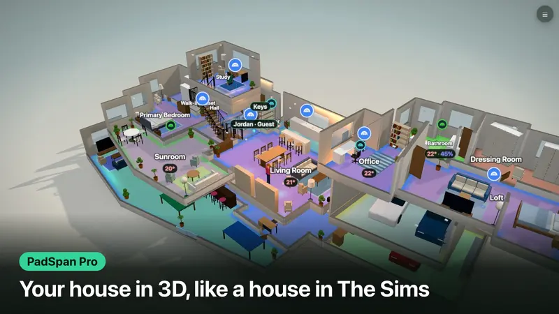
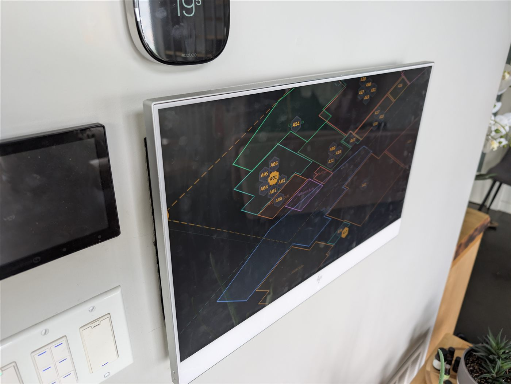

# PadSpan™ HA

### Your house as a Home Assistant control panel: every light on your floor plan, room presence for each phone, watch and tag, and the house in 3D on a wall screen

PadSpan is an eminently intuitive control panel that gives you real mastery of your residence. Make it as simple or as complex as you need, and keep what you use most a tap away. Once it's a familiar part of your routine, you'll feel confident you have your space in the palm of your hand.

It's a Home Assistant integration. It draws your house from its floor plan, floor by floor, with every light, lock and alarm in its room. With Bluetooth scanners it also shows which room each phone, watch and tag is in, every 5 seconds, and your automations get room, distance and home/away sensors. The tracking runs locally. I make PadSpan and use it every day in my own house: three floors, 5,000 sq ft and a 4K wall screen.

▶️ **Try it in your browser: [padspan.traks.ca/demo](https://padspan.traks.ca/demo/)**, the real panel on a sample house. The demo shows PadSpan Pro. Nothing to install.

 **Install:** one click opens PadSpan in **Settings → Marketplace** (Home Assistant 2026.11 and newer) or in HACS (older versions). Or search either one for PadSpan.

**Free and open source (GPL-3.0).** The free version needs no key and doesn't run out. From December 1, 2026, placing each light exactly where it hangs, the plain wall screen and the house in 3D are free too; until then they are Pro. PadSpan Pro is the one purchase for the rest: fixture shapes, Furnish, people in 3D, the 3D editor, the wall screen's extras and every add-on. **Try all of Pro free for 90 days, no card.** The anonymous usage report stays on during the trial ([how it works](./docs/PADSPAN_PRO.md)).

🌐 **Website: [padspan.traks.ca](https://padspan.traks.ca)** · [PadSpan Pro](https://padspan.traks.ca/pro/) · [Add-ons](https://padspan.traks.ca/add-ons/) · 📖 **Guides:** [From the Marketplace to your first room](https://padspan.traks.ca/guides/get-started/) · [What can Home Assistant do once it knows the room?](https://padspan.traks.ca/guides/room-presence-automations/) · [Bermuda, NeonPlan 3D or PadSpan?](https://padspan.traks.ca/guides/bermuda-vs-neonplan/) · [Which room is my phone in?](https://padspan.traks.ca/guides/phone-room-presence/) · [Which Bluetooth tag works?](https://padspan.traks.ca/guides/bluetooth-tags/) · [Why does my phone jump between rooms?](https://padspan.traks.ca/guides/room-flapping/) · [How many Bluetooth proxies do I need?](https://padspan.traks.ca/guides/bluetooth-proxies/) · [Your Shellys can be Bluetooth proxies](https://padspan.traks.ca/guides/shelly-bluetooth-proxy/) · [Which floor plan for Home Assistant?](https://padspan.traks.ca/guides/floor-plans/) · [Your robot vacuum's map as your floor plan](https://padspan.traks.ca/guides/robot-vacuum-floor-plan/) · [Every floor of a big house on one wall](https://padspan.traks.ca/guides/large-homes/) · [Which touch screen for a PadSpan wall?](https://padspan.traks.ca/guides/wall-screens/) · [Bermuda and PadSpan together](https://padspan.traks.ca/guides/bermuda/) · [all guides](https://padspan.traks.ca/guides/) · 🎬 **Making a video or article?** [The creators kit](https://padspan.traks.ca/creators/)

The tour is the real panel on the demo's sample house, at real speed, with captions added. Most of it shows PadSpan Pro; the Who's where now screen at the end is free. Each part of the demo, the wall screen included, opens from [padspan.traks.ca](https://padspan.traks.ca/#demo).

---

## What do you want PadSpan for?

Each of these works on its own, and they all share one map of your house.

### The whole house on one screen

**Free** · Pro adds wall mode and exact placement (both free from December 1, 2026)

- **What you see:** the Atlas, a page of its own in the Home Assistant sidebar, with every floor of your house and each light, fan, lock and sensor in its room. A leak, smoke, gas or CO alarm turns its room red, and a red banner stays on every PadSpan screen for two days or until someone presses Reset. A house alarm going off shows in the same banner.
- **What you tap:** a light to switch it, a room's name for its card with All on, All off and the room's scenes, and a lock to lock or unlock it. Unlocking asks first.
- **Needs:** Home Assistant 2024.8 or newer and your rooms on a plan (the rough house from your Home Assistant areas takes two presses). No Bluetooth scanner.
- **With Pro:** wall mode fits every floor to a wall screen, sizes the text for the room and dims at night. From December 1, 2026 the plain wall screen is free, and dimming at night stays Pro. Arming your alarm, the door and garage card, and each room's speakers, shades and thermostat come with Pro or an add-on. [See it in the demo](https://padspan.traks.ca/demo/?page=atlas)

### Who's in which room

**Free** · Busy Times and Locate need Pro or the Presence insights add-on

- **What you see:** **Who's where now**, on the first screen, puts each phone, watch and tag in the room whose Bluetooth scanner hears it best, from each scanner's Home Assistant area. No floor plan needed. Once your rooms are drawn, Overview shows everyone on every floor, and Traceback replays the last 7 days.
- **What you tap:** **Track** names a phone that Home Assistant already tells apart, and PadSpan tracks it from then on. **Set room** gives a scanner with no area its room. Guests get a small Bluetooth tag for their visit, so PadSpan shows which room they're in.
- **Needs:** at least one Bluetooth scanner: an ESPHome Bluetooth proxy, a Shelly Gen2 or newer set as a Bluetooth scanner ([one setting](https://padspan.traks.ca/guides/shelly-bluetooth-proxy/)), your Home Assistant machine's own Bluetooth, or an ESPresense node. One tells you home or away, one in each room you want told apart gives you rooms, and three or more placed on a measured plan add positions between them. [How many proxies do I need?](https://padspan.traks.ca/guides/bluetooth-proxies/)
- **Already running Bermuda?** Keep it. [PadSpan runs next to it](https://padspan.traks.ca/guides/bermuda/) on the same proxies. [See it in the demo](https://padspan.traks.ca/demo/?page=panel)

### Your floor plan, and the house in 3D

**Free** plan · the 3D house is **Pro** (free from December 1, 2026)

- **What you see:** your floors stacked one above the other, each room drawn to scale. With Pro, and free from December 1, 2026, Live Aboard turns the same map into the house in 3D, like looking into a house in The Sims, with split levels, lofts and room heights as they really are.
- **What you do:** bring in a plan however you have one: a picture or a PDF, a photo of your own sketch, a blank floor you type the size of, a rough house from your Home Assistant areas, a plan file from Easy Floorplan, DXF or Floorplanner, an iPhone or iPad Pro LiDAR room scan, or your robot vacuum's map (experimental). Every one of these is free until December 1, 2026; from then a LiDAR scan needs Pro or the Advanced map creation add-on, and a robot vacuum's map needs Pro, the Robot vacuum add-on or a Bright Pro key. Then trace the rooms and mark the walls, doors and windows.
- **Needs:** Home Assistant. A LiDAR scan needs an iPhone 12 Pro or a newer Pro model, or an iPad Pro from 2020 or later, and a RoomPlan app that shares USDZ. The 3D house needs a browser with WebGL. [See the 3D house in the demo](https://padspan.traks.ca/demo/?page=atlas3d)

### Every light where it hangs

**Free** · Pro places each light exactly (free from December 1, 2026)

- **What you see:** every light on the map in its room. With Pro, and free from December 1, 2026, each one sits where it really hangs. Pro gives it its real shape, size and angle, from pot lights and pendants to WLED strips, and Automorph draws its glow into the room.
- **What you tap:** a light to switch it. A wall dimmer or switch and the smart bulbs it feeds can run as one light, a power team: tap its card to switch it and drag to dim. Its brightness and colour follow the time of day, and it can wake you, wind down for bedtime and keep a night light. Making or changing a team, following the day, Sleep and the wake-up need Pro or the Advanced smart lighting add-on; a team already made keeps switching and dimming without it.
- **Needs:** your lights in Home Assistant, in the areas that match your rooms. [See it in the demo](https://padspan.traks.ca/demo/?page=atlas)

---

## Start without Bluetooth scanners

You can start with the map and the lights and add room presence later.

1. Install PadSpan. With no scanner heard yet, it opens on a sample house. Press **Back to my house** (an administrator's press while Enhanced security is on).
2. In **Setup**, press **Show what it will make**, then **Make the rough house**. You get one box per Home Assistant area, on a floor for each Home Assistant floor. It leaves everything else alone, and a second press makes nothing new. Or upload a plan, a PDF or a LiDAR scan instead.
3. Open **Atlas** in the Home Assistant sidebar. Your lights are in their rooms. Tap one to switch it.

Without a scanner you still get locks, the leak, smoke, gas and CO alarms with their red banner and notifications, a house alarm going off, Alert pulse, the power teams already made, every way to a plan (from December 1, 2026, all but a LiDAR scan and a robot vacuum's map), and Open screens with announcements. When you want to know who's in which room, add one Bluetooth scanner.

---

## Editions

### Free

PadSpan HA is free and open source (GPL-3.0). The free version needs no key and doesn't run out. It covers room presence with a week of replay, every way to a floor plan (from December 1, 2026, all but a LiDAR scan and a robot vacuum's map), every light on the map in its room with a tap to switch it, locks, alarms that turn their room red, and the sensors and events for your automations. From December 1, 2026 it also places each light and device exactly where it is, shows the plain wall screen and builds the house in 3D (Live Aboard); until then those are Pro. Some features need PadSpan Pro or an add-on, and PadSpan says which where you meet them. Pro includes every add-on.

A key turns on the rest in the same install. Enter it in **Settings → Features → PadSpan licence**.

### PadSpan Pro

PadSpan Pro is the one purchase. It covers everything below, including every add-on, and every new PadSpan feature is included while your key runs. Buying it pays for the work and keeps new releases coming every week.

With PadSpan Pro you can:

- **Put each light and device exactly where it is.** Drag lights, fans, locks and sensors to their real spot, and give each light its real shape (pot light, pendant, sconce, strip, chandelier), size and angle. WLED strips get live brightness, colour and effects, and **Exact look** brings a WLED light on the same way every time. **Automorph** draws each light's glow into its room, and **Fit room** keeps it inside the walls. From December 1, 2026, placing them is free, drawn as plain markers; the shapes, WLED, Automorph and Fit room stay Pro.
- **Look into your house in 3D.** Live Aboard builds the house from the map you drew, like looking into a house in The Sims. Lights glow in their real colour, the house darkens with the real sun, lit windows show from outside after dark, and rain and snow fall outside the walls. The **Studio** look puts the house on a stage under a sky that follows the sun. Until December 1, 2026, Live Aboard is experimental and off until you turn it on. From then the 3D house itself is free (turn, pan and zoom, floors, rooms, walls and lights), and a new install starts with it on; rain and snow stay Pro.
- **Walk through it.** **Walk** puts you at eye height just inside the front door. Walls and closed doors stop you, a door with a sensor opens when the real one does, and the stairs take you up and down. From December 1, 2026, Walk comes with the free 3D house.
- **Have the view fly to what just happened.** An administrator picks what to watch in Settings, and on the sidebar and wall screens the 3D view flies to a doorbell that rings, a door that opens or an alarm that goes off, shows its card (with a camera's snapshot if you pick one), and goes back after 20 seconds.
- **Furnish it.** 33 kinds of furniture with their own sliders, a whole room furnished in one tap, stairs, floors and wall colours. Link a piece to a device and a lamp glows in its light's colour, the TV lights up while it plays and the washer shakes while it runs.
- **Put the house on the wall.** Wall mode (`/padspan-lights?kiosk=1`) fits every floor to the screen, sizes the text for the screen and how far away people stand, dims at night and fades its controls 30 seconds after the last touch. With the new Atlas layout, each screen picks what it shows. From December 1, 2026, the plain wall screen is free; dimming at night, the burn-in shift, floors in turn and Fully Kiosk motion wake stay Pro.
- **Make the Atlas your first screen.** Overview shows the Atlas, or the 3D house, in place of the classic map.
- **See people and tags on the map**, flat or in 3D, each where PadSpan has them.
- **Use every add-on below** without buying it separately.

One key covers up to five homes; with more than two, each home keeps its usage report on. A key keeps working for 14 days after its end date. Then the paid features switch off, but nothing you set up is deleted, and it stays readable and exportable.

**Try all of Pro free for 90 days, no card.** An administrator starts it in **Settings → Features → PadSpan licence**, one trial per home, and the anonymous usage report stays on until it ends. Testers get two years of Pro (one year if they join from December 16, 2026) while their usage report stays on, and until December 31 the first 20 people to ask get a year ([details](https://github.com/gbroeckling/padspanHA/discussions/92)).

Everything Pro does: [padspan.traks.ca/pro](https://padspan.traks.ca/pro/). Prices and buying: [padspan.traks.ca/#pro](https://padspan.traks.ca/#pro). The trial, keys and homes: [PadSpan Pro](./docs/PADSPAN_PRO.md).

### Add-ons

Just want one thing? Each add-on adds one area of PadSpan to an install without Pro. **PadSpan Pro includes all of them.** Each is one payment that covers two years on up to three homes. There's no subscription, and one key carries every add-on you buy. Add-ons need the latest PadSpan.

| Add-on | What it adds | Needs |
|:--|:--|:--|
| [Audio](https://padspan.traks.ca/add-ons/#audio) | Each room's card on the Atlas gets its speakers' volume, mute and off, and **Room off** for the room's lights and music together. A speaker shows beside a room's name while it plays. The room's shades are free; its thermostats are Climate & air quality's | Players from Control4, Crestron, Savant, Russound, Nuvo, Monoprice, Xantech, Triad, Denon, Yamaha or Anthem, or any Home Assistant speaker with a volume; rooms that are Home Assistant areas |
| [Alarm & security](https://padspan.traks.ca/add-ons/#alarm) | Arm and disarm your Home Assistant alarm from the Atlas's emergency button (each one asks first, with the code when the alarm has one), open and close garage doors and gates from one card per door with its opener and lock, and test the emergency lights. Openers and locks can be built from plain relays | An alarm panel in Home Assistant, such as Alarmo; covers, switches or relays for openers. An alarm going off, leak and smoke alarms, locks and Alert pulse stay free without it |
| [Wi-Fi coverage](https://padspan.traks.ca/add-ons/#wifi) | A Wi-Fi map of each floor, 2.4 GHz and 5 GHz apart, with each room's signal and a list of what to fix | UniFi access points and the UniFi Utopia integration, whose survey is still a test build |
| [Climate & air quality](https://padspan.traks.ca/add-ons/#climate) | The ♨ Heatmap chip colours each room by its temperature, humidity or CO₂, from that room's own sensors, and each room's card gets its thermostats: temperature, mode, and the setpoint with − and + | Those sensors and thermostats in the Home Assistant areas that match your rooms |
| [Full house activity](https://padspan.traks.ca/add-ons/#activity) (listed as Time travel in PadSpan 0.38.300 and 0.38.301) | Turns on **🏠 Full house activity** in **Traceback → Playback**, which plays any stretch of the last week back in Traceback on your Atlas map: every light, door, lock and sensor, with the people and tags | Rooms on a floor plan; Bluetooth scanners for the people; Home Assistant's recorder for the devices |
| [Vacation Mode & presets](https://padspan.traks.ca/add-ons/#vacation) | Vacation Mode learns each light's routine from Home Assistant's history and keeps it going while you're away. Whole-house presets save how every light and fan is set, and **Apply** puts it all back after asking | A week of light history in Home Assistant's recorder before a trip |
| [Looks pack](https://padspan.traks.ca/add-ons/#looks) | Day, Graphite, Ocean and Dusk themes for the panel, and Showcase, 20 looks for the whole Atlas, the West Coast Forest among them, with saved look presets. The light glow (Automorph) is Advanced smart lighting's | Nothing more |
| [Presence insights](https://padspan.traks.ca/add-ons/#insights) | **Locate** gives room-by-room directions from your phone to a tag, such as your keys. **Busy Times** shows which rooms are busiest, hour by hour, over 1, 3 or 7 days. **Forensics** records which Bluetooth devices were near your scanners, searchable by time and exported as CSV, kept 7 to 90 days on your own Home Assistant. Not to be confused with Traceback's free Insights tab | Bluetooth scanners and a tracked phone or tag; for Locate, rooms that touch on the plan |
| [Advanced smart lighting](https://padspan.traks.ca/add-ons/#lighting) | Power teams that follow the day, sleep and wake you (making, changing and removing a team too; a team already made keeps switching and dimming without it), WLED's Advanced controls, Automorph, Scene, Ripple, Light spread, Fit room, Hide untouched, fixture shapes with their size and angle, and the type override. Placing a light where it really is stays Pro until December 1, 2026, then it is free | Lights in Home Assistant; for a power team, a wall dimmer or switch and the smart bulbs it feeds |
| [Advanced map creation](https://padspan.traks.ca/add-ons/#maps) (on sale from December 1, 2026) | AI plan reading, reading a photo, a LiDAR scan's doors, windows, furniture and stairs in the 3D house, Furniture from scans, and floor plans from a LiDAR scan. All free until it goes on sale | For a scan, an iPhone 12 Pro or a newer Pro model, or an iPad Pro from 2020 or later |
| [Robot vacuum](https://padspan.traks.ca/add-ons/#vacuum) (on sale from December 1, 2026) | Your robot vacuum's map as a floor plan, the robot on the Atlas map and in 3D with its card, room location runs, the mistake finder and Wi-Fi while it cleans (with Wi-Fi coverage). Free until it goes on sale; a Bright Pro key keeps them | A Valetudo, Dreame or Xiaomi robot; a Valetudo robot for the live robot and its card |

Holding Advanced map creation or Robot vacuum takes 30% off the other, bought from the licence card with the email the key was sent to. The better of that and any sale applies, never both.

Details and prices: [padspan.traks.ca/add-ons](https://padspan.traks.ca/add-ons/).

### PadSpan Bright

[PadSpan Bright](https://github.com/gbroeckling/padspanBright) is a separate, lighter download made from this same source: the Atlas on its own, for anyone who wants the lighting map without room presence. A PadSpan Pro key turns on Bright's tools too, one key for either download. Bright's own key, PadSpan Bright Pro, is sold until December 15, 2026.

---

## What's in PadSpan, area by area

Everything here is free unless it says Pro or names an add-on, and Pro includes every add-on.

### Presence

- Each phone, watch, tag and beacon goes to the room whose scanner hears it best, checked every 5 seconds. Signals are smoothed with a Kalman filter, and a move to another room waits 40 seconds by default, so a phone doesn't flick between rooms. [Why does my phone jump between rooms?](https://padspan.traks.ca/guides/room-flapping/)
- Rooms come from each scanner's Home Assistant area, so a floor plan is optional. With three or more scanners placed on a measured plan, PadSpan also places devices between them.
- ESPHome Bluetooth proxies, Shelly Gen2 or newer set as Bluetooth scanners, and Home Assistant's own Bluetooth come in through Home Assistant with nothing to set up. ESPresense nodes come in over MQTT once you switch them on in **Manage → HA Entities → ESPresense MQTT** (it needs Home Assistant's MQTT integration). ESP32s running Tasmota with Bluetooth come in the same way (experimental: **Manage → HA Entities → Tasmota BLE**).
- Readings from another floor count for less. While a device is indoors, readings for a room on an Outside floor count 15 dB weaker, and a move between indoors and outdoors needs every vote in the window unless the position on the map agrees. Floor-transition learning is experimental and off by default.
- Each device keeps one PadSpan ID through Bluetooth address and iBeacon changes. **Devices** lets you merge duplicates, add identities, relabel and delete.
- Keys and tags nobody carries can keep their last room for half an hour up to 2 days after they go quiet (off by default).
- **Calibration:** **Walk a room** has you carry one phone or tag round a room for 90 seconds, or you can calibrate point by point. The Calibration screen also has Tune, Beacon Tune, Pin & Listen, Roam and Accuracy by spot, and it works on the phone you carry.
- **Scanner hardware:** tested with more than 20 ESP32 boards. The antenna matters more than the chip, so pick a board with an external antenna: an ESP32-S3 with Ethernet or Wi-Fi, or an ESP32-C3. PadSpan shows each scanner's signal health, Wi-Fi and connection, and **Health** lists the problems it finds with a button to the screen that fixes each one.

### Phones, watches and tags

Phones change their Bluetooth address about every 15 minutes for privacy, so each kind of device has its own way in:

| Device | Easiest Method | What You Need |
|--------|---------------|---------------|
| **Android phone** | HA Companion App iBeacon | Install app, enable BLE Transmitter. Done. |
| **iPhone / iPad** | IRK via [irk-capture](https://github.com/DerekSeaman/irk-capture) | Spare ESP32, flash irk-capture, pair once, paste IRK |
| **Apple Watch** | IRK via irk-capture | Same as iPhone — pair watch to irk-capture ESP32 |
| **Beacon or key tag with a fixed ID or address** | Automatic | Name it once and the name sticks. [Which Bluetooth tag works?](https://padspan.traks.ca/guides/bluetooth-tags/) has what to buy and how to test a tag. Older Tiles work this way; Life360 is moving newer ones to changing addresses, so test yours |
| **AirTag and other Find My tags** | Probabilistic (experimental) | Enable **MAC Rotation Bridging** in Settings → Features. They change address every 15 min near their owner's iPhone and once a day away from it, with no stable identifier, so bridging links a named tag to its next address when it's clear which one it is. It works while the tag stays in range, won't guess between two tags together, and a tag that was out of range when it changed comes back nameless. **Apple Device Classification** only adds a label |
| **SmartTag** (Samsung) | Not reliably | No stable identifier in the air. MAC Rotation Bridging has only a fingerprint to go on |
| **AirPods** | Apple auto-classification | Detected and labeled automatically when feature enabled (display only — does not solve identity) |

iPhones can also come in through Home Assistant's Private BLE Device. The **Phone Setup Wizard** (experimental) shows the three ways in for a phone. For irk-capture it asks the device's name and whose it is first, then picks up the key the ESP32 shows in Home Assistant; [Which room is my phone in?](https://padspan.traks.ca/guides/phone-room-presence/) walks through it.

For devices where you can't get an IRK, the experimental **MAC Rotation Bridging** feature matches advertisement patterns across address rotations to maintain tracking continuity.

> **Acknowledgement:** The IRK extraction workflow is built on [Derek Seaman's irk-capture](https://github.com/DerekSeaman/irk-capture) — an ingenious ESP32 tool that emulates BLE peripherals to extract Identity Resolving Keys during pairing. It's what makes practical phone tracking in Home Assistant possible without rooting devices or owning a Mac.

### Guests

Guests get a small Bluetooth tag for their visit, so PadSpan shows which room they're in. Each stay has the guest's name, an end date and its own report (when they arrived and left, and time in each room), kept 30 days by default and then deleted with the name. The name stays in Home Assistant and never goes in the usage report or a backup. Turn it on in **Settings → Tracking → Phones and guest tags → Guest tags**; a **Guests** screen appears while it's on. The [Guest Tags Guide](./docs/GUEST_TAGS_GUIDE.md) has the details.

### History and alerts

- **Traceback** replays the last 7 days of movement on your floors, NVR-style, with **Insights**: time in each room, entries and peak occupancy, exported as CSV or JSON.
- **Share a replay** makes a 10 to 30 second clip from a stretch of Traceback. Names become Person 1 or initials, and the clip has no plan picture, address or coordinates in it. It's made in your browser as MP4, WebM or GIF, and nothing is uploaded.
- **Follow** shows one device's room live with its movement timeline, and alerts you when it changes room, arrives or leaves. Alerts go through Home Assistant's own notify services: the Companion app for a phone, or a mail integration such as SMTP for email. PadSpan has no mailer of its own. Room-change alerts are held to one a minute per device.
- **Yesterday at home** sends one morning message about the day before: comings and goings, guests, the rooms empty longest and lights left on in empty rooms (off until you turn it on).
- **Lights follow people** turns a room's lights on when someone with a named phone, watch or tag walks in, and off once the room has been empty for the time you set (2 minutes by default). It can wait for dark and keep quiet hours, and a light you turn off by hand stays off. Off until you turn it on, in **Settings → Tracking → Home Assistant and integrations**.
- **Occupancy** counts people in the building, never devices.
- **Busy Times** and **Locate** are Pro or the Presence insights add-on. **Full house activity** on the Atlas is Pro or the add-on of the same name, and **Forensics** is Pro or the Presence insights add-on, with Busy Times and Locate.

### What Home Assistant gets

- A device tracker for each named device (its state is the room, or `not_home`), area and distance sensors, occupancy sensors per room (off by default), sub-zone sensors, and binary sensors for Vacation Mode and guests at home. Each power team is one Home Assistant `light`.
- Events when a named device arrives or leaves (`padspan_device_arrived`, `padspan_device_departed`), when a followed one changes room (`padspan_room_change`), and for guest tags (`padspan_ha_guest`).
- `padspan_ha.announce` puts a big message with a chime on the PadSpan screens you name, read aloud, and `padspan_ha.reload_screens` reloads them (both need **Open screens** on).
- Assist answers "Which room is Alex in?" once you add PadSpan's sentences, and `/padspan-ha?room=Kitchen` or `?follow=Alex` opens a room's card or Follow straight away.
- Three blueprints: room lights follow people, lights on in whichever room you walk into, and lights off when a room is empty. [What can Home Assistant do once it knows the room?](https://padspan.traks.ca/guides/room-presence-automations/) has eight tested recipes.

### Floor plans and rooms

- Every way in is free (from December 1, 2026, a LiDAR scan needs Pro or the Advanced map creation add-on, and a robot vacuum's map Pro, the Robot vacuum add-on or a Bright Pro key): a picture (PNG, JPG, GIF, BMP, WebP or SVG; a photo of a sketch works), a PDF (you pick the page), a blank floor you type the size of, the rough house from your Home Assistant areas, a plan file from another app (Easy Floorplan YAML, DXF or Floorplanner FML), an iPhone or iPad Pro LiDAR room scan (drawn to scale, with room outlines suggested), a Sweet Home 3D file, or a robot vacuum's map (experimental).
- Set the scale with a two-point measure (a doorway works; a long wall is more exact), then trace each room over the plan.
- Floors come from Home Assistant's floors and line up in **Mapping → 3D Stack**, each with its own height. Each room can have its own ceiling height and a split level (the 3D house, which is Pro until December 1, 2026 and free from then, draws them).
- Walls carry their material (metal, concrete, brick or your own figure), which PadSpan counts as signal loss between rooms, and an open edge for a loft. Doors and windows sit on a wall, linked to their sensors.
- **Sub-zones** mark a bed, a couch or a desk inside a room, each with its own sensor (off by default).
- Renaming an area in Home Assistant renames it in PadSpan too.
- Overview draws every floor stacked, with everyone on it and their trails if you want them.

### The Atlas

The Atlas is the house as a control panel. It has its own page in the Home Assistant sidebar, made for a screen you leave up, and anyone in the household can use it without being an administrator.

**Free**
- Floors and rooms, with each light, fan, lock and sensor as a marker in its room. Tap a light to switch it. Tap a room's name for its card: All on, All off, and its scenes and scripts.
- Locks lock and unlock from the map and the room's card, and unlocking asks first.
- Leak, smoke, gas and CO alarms ring their room red and stay up for 2 days or until someone presses Reset, with a red banner on every PadSpan screen and a notification when one goes off and when it clears. A house alarm going off shows in the emergency button and the same banner.
- **Alert pulse** (off by default) rings a room amber when a door, window, gate or cover there has been open more than 6 hours, or a window is open while it rains or snows.
- **Power teams** (**Settings → Atlas → Power teams**) run a wall dimmer or switch and the smart bulbs it feeds as one light that follows the day, with a wake-up, a bedtime, a night light and fades of up to 100 minutes. Making or changing a team, following the day, Sleep and the wake-up need Pro or the Advanced smart lighting add-on; a team already made keeps switching and dimming without it.
- Rain or snow outside the house, from a rain sensor, a weather entity or a weather-warning service, drawn still (Pro animates it).
- Hover, or hold a finger, to name what's under it; **Alt+click** steps through markers stacked on one spot. Pinch, drag and tap are tuned for a wall panel or a phone.

**Pro**
- Each light and device placed exactly (free from December 1, 2026, drawn as a plain marker), in its real shape, size and angle; WLED Advanced and **Exact look**; **Automorph** (16 styles, such as Glow, Blueprint, Nebula and Halo); **Fit room**; **Light spread**; spatial scenes (Sunset, Dusk, Ember, Ocean) across the floor; the scene row, a tile for each Home Assistant scene that sets a placed light; animated rain and snow.
- The new layout, where each screen ticks what it shows; **Edgecut**, where the rooms fill the screen; wall mode (the plain wall screen is free from December 1, 2026); the Atlas as your Overview; people and tags on the map.

**Pro or an add-on**
- **Audio:** each room's speakers and Room off, in its card. A room's shades in its card are free.
- **Alarm & security:** Arm and Disarm in the emergency button, the emergency lights test, the door, garage and gate card with its opener and lock, and **Devices → Door Openers**.
- **Climate & air quality:** the Heatmap chip and each room's thermostats in its card. **Vacation Mode & presets:** Vacation Mode and Whole house presets. **Looks pack:** Showcase and its 20 looks. **Full house activity:** Traceback's playback of the whole house on the Atlas.
- **Advanced smart lighting:** making and changing power teams, with their day, Sleep and wake-up, and from the Pro list above the shapes and type override, WLED Advanced, Automorph, Scene, Ripple, Light spread, Fit room and Hide untouched.
- From December 1, 2026: **Advanced map creation** for AI plan reading, reading a photo and everything from a LiDAR scan, and **Robot vacuum** for everything a robot vacuum does in PadSpan. Both are free until then.

### The 3D house (free from December 1, 2026) and Furnish (Pro)

Live Aboard is the Atlas in 3D, built from the map you already drew. Until December 1, 2026 it's Pro, experimental and off until you turn it on in **Settings → Atlas**. From then the 3D house itself is free, with Walk, and a new install starts with it on; people figures, Edit and its wizard, the view flying to an alert, Furnish, the shared library and rain and snow stay Pro. It needs a browser with WebGL.

- **Getting around:** drag, pinch or double-tap a room; Top, Iso, turn 90° and Fit; walls cut away, up, down, as glass or with the roof on; one floor at a time, all of them, or pulled apart. Save views and set a home view, and the view can go back to it by itself after 30 seconds to 5 minutes.
- **Using it:** tap a light to switch it and hold it for brightness, colour and effects; tap a sensor for its card; tap a room's name for its devices and scenes.
- **What it shows:** each room's temperature, humidity and air quality under its name, motion by how recent it is, leak, smoke, gas and CO alarms ringing their room, and a window open in the rain glowing blue. Lights glow in their real colour, and the house darkens with the real sun.
- **Looks:** Classic, **Studio** (the house on a stage under a sky that follows the sun, from golden hour to stars) and Showcase, chosen per screen, with one look by day and another after sunset if you like.
- **People and tags:** each Home Assistant person walks to the phone or tag they carry, as a figure you make with sliders or a soft marker.
- **Walk** at eye height through the house, and **fly to** a doorbell, a door or an alarm when it goes off.
- **Edit:** doors in ten kinds (hinged, French, sliding, barn, pocket, bifold, garage, roll-up, tilt-up, gate) that follow their sensor or cover, windows with their sill and head, LED strips round a room or along a rail, and mezzanines inside a tall hall. A step-by-step wizard sets the house up.
- **Furnish:** 33 kinds of furniture with their own sliders, room sets that furnish a kitchen, bathroom, bedroom, living room, dining room or office in one tap, stairs (straight, L, U, open or floating), floors (wood, tile, stone, carpet, concrete) and wall colours. Pieces linked to a device come alive. A shared furniture library is there if an administrator switches it on, and Sweet Home 3D files bring their doors, windows, furniture and stairs.
- When nothing in the house changes, it draws nothing.

Guides: [Live Aboard Guide](./docs/LIVE_ABOARD_GUIDE.md) and [Furnish Guide](./docs/FURNISH_GUIDE.md).

### Wall screens

- **Wall mode (Pro; the plain wall screen is free from December 1, 2026)** on `/padspan-lights?kiosk=1` fits every floor to the screen, grows the text with the screen (twice the size on 4K), hides Home Assistant's sidebar, keeps the screen awake over HTTPS and fades its controls 30 seconds after the last touch. **Settings → Atlas → Wall screens** sizes it for the room: give the screen's size and how far away people stand, or tap a preset from desk monitor to big TV. **Dim at night** darkens it between sunset and sunrise, and stays Pro with the burn-in shift, floors in turn and Fully Kiosk motion wake.
- **Open screens** (free, off by default) lists every PadSpan page that's open in the house, so you can reload one or all and give each a name, and lets `padspan_ha.announce` reach them.
- Guides: [Wall Screen Guide](./docs/WALL_SCREEN_GUIDE.md), [Which touch screen for a PadSpan wall?](https://padspan.traks.ca/guides/wall-screens/) and [Every floor of a big house on one wall](https://padspan.traks.ca/guides/large-homes/).

### Look, language and help

- **23 dedicated views** with Basic and Advanced modes: Basic keeps a short main list, and the rest sit under More tools.
- Themes: Night, Light and High contrast for everyone; Day, Graphite, Ocean and Dusk with Pro or the Looks pack add-on. **Follow the sun** switches to a light theme by day.
- The panel speaks your Home Assistant profile's language when it's German, French or Dutch. German covers nearly all of it; French and Dutch leave the Atlas map, the 3D house, Furnish, Rooms and Traceback in English.
- Metres, or feet and inches.
- A built-in **Training Hub** with 16 animated walkthroughs, and the full manual.
- **Sample mode**: **Preview a finished house** shows a sample house with every feature set up, before your own hardware is in. **Back to my house** returns to yours.

### Robot vacuums and Wi-Fi

- **Robot vacuum (experimental, off by default):** a Valetudo, Dreame or Xiaomi map becomes your floor plan with its rooms. A Valetudo robot also shows live on the map with its card (state, battery, Start, Pause, Dock). With a Bluetooth beacon on top, its room location runs add calibration spots as it drives (a backup first, Undo for each run, and it stops below 20 % battery), and **Find mistakes** lists receivers that look misplaced. Free until December 1, 2026; from then it needs Pro, the Robot vacuum add-on or a Bright Pro key, and nothing stored is deleted.
- **UniFi access points** from UniFi Utopia show on the Atlas with your other devices. The coverage map is the Wi-Fi coverage add-on.

### Experimental (Settings → Features)

- **Phone Setup Wizard**: a guided flow for phones and watches. It points to [irk-capture](https://github.com/DerekSeaman/irk-capture) for IRK extraction, and also shows the easy Android path (HA Companion App iBeacon) and Apple IRK options.
- **MAC Rotation Bridging**: when a phone's Bluetooth address rotates (every ~15 min), PadSpan matches advertisement characteristics (company ID, services, signal pattern) to tentatively link old and new addresses. It bridges the gap without an IRK, and it's probabilistic, so it may now and then link the wrong devices.
- **Apple Device Classification**: shows what sent an Apple Find My signal (AirTag, a Find My accessory, which can be another brand's tag or AirPods, or an Apple device such as an iPhone, iPad or Mac) instead of just "Find My", in Devices, Bluetooth → Advertisements and a device's details. It can't tell an iPhone from an iPad or a Watch, because nothing Apple sends over Bluetooth says which. Display only: it doesn't affect tracking or identity.
- **Radio Map**: an RSSI heatmap overlay using inverse distance weighting.
- **Signal distortion map**: where positions matched to calibration points (k-NN) disagree with reality.
- **Walk-to-Identify**: find unknown devices by matching them to your walking.
- **RoomPlan Import**: import an Apple RoomPlan scan (a `.usdz` file, or RoomPlan JSON) in Mapping → Layout, as rooms to review before anything is saved.
- **Robot Vacuum Import**: import a robot vacuum's map (Valetudo, Dreame or Xiaomi) in Mapping → Layout as a floor plan with its rooms.
- **iPhone Setup Path**: walks an iPhone through getting its IRK, adding it and checking it resolves (on by default for a new install).
- **RSSI Vector Capture**: record what every scanner heard, poll by poll, to replay a walk offline against changed settings.

---

## Screenshots

### On the wall in my house

It hangs next to the thermostat and the light switches.

### The demo's sample house

| The Atlas on a wall screen (Pro) | The main floor in 3D at night (Pro) |
|:-:|:-:|
|  |  |

| Who's where now on a new install (free) | The 3D house on a wall screen (Pro) |
|:-:|:-:|
|  |  |

| On a phone: the panel | On a phone: the Atlas | On a phone: the 3D house |
|:-:|:-:|:-:|
|  |  |  |

---

## How It Compares

[Bermuda](https://github.com/agittins/bermuda) and [ESPresense](https://espresense.com/) are both good, and lots of people run them. This is what each does, from their own docs as of October 2026 ([more detail](https://padspan.traks.ca/guides/bermuda-vs-espresense/)). If something here is out of date, [open an issue](https://github.com/gbroeckling/padspanHA/issues) and it gets fixed.

| | PadSpan HA | Bermuda | ESPresense (+ Companion) |
|:--|:--|:--|:--|
| Room-level presence | ✅ | ✅ | ✅ |
| Hardware | ESPHome Bluetooth proxies, Shelly Gen2+, HA's own Bluetooth or a USB adapter, or ESPresense over MQTT once switched on | ESPHome Bluetooth proxies, Shelly Gen2+, USB adapters | Its own firmware on ESP32 nodes |
| Floor plan needed? | No: rooms come from each scanner's HA area; the map is optional | No | No for rooms; Companion's map needs your rooms as coordinates (YAML, or made with MagicPlan or its Floorplan Creator) |
| Map of your home | ✅ draw rooms on your floor plan | — | ✅ Companion |
| Multi-floor 3D view | ✅ (the 3D house, Live Aboard: free from December 1, 2026; its editor and Furnish are Pro) | — (has a Floor sensor) | ✅ Companion |
| Position between scanners | ✅ with 3+ scanners placed on a measured plan | — | ✅ Companion (X/Y/Z) |
| Calibration | Walk-around fingerprints and per-scanner signal fit | Guided: global, per proxy and per device | Manual on each node; automatic in Companion |
| Signal smoothing | Kalman filter plus a room vote | Averaging, a speed limit on moving away, and area hysteresis | Filtering on the node, Kalman on position (Companion) |
| iPhones and Apple Watches (IRK) | ✅ via Private BLE Device or irk-capture, with a setup guide | ✅ via Private BLE Device | ✅ enrolled on the node's web page |
| Tags that change address (AirTag, SmartTag) | Experimental | — | — (AirTags can only be counted) |
| HA room, distance and tracker entities | ✅ | ✅ | A room sensor with distance; a tracker from Companion |
| Movement history | ✅ playback (Traceback) | HA's own history, no playback | Path view in Companion (its history logging is in beta) |
| Alerts when a device changes room | ✅ built in (Follow) | With your own HA automations | With your own HA automations |
| Where you set it up | A PadSpan panel in the HA sidebar | Home Assistant's setup dialogs | The node's web page and the Companion app |
| Try it before installing | ✅ [browser demo](https://padspan.traks.ca/demo/) and a sample house | — | — |

Room Assistant isn't in the table: its last release was in March 2022.

Already running Bermuda? Keep it: PadSpan runs next to it on the same proxies and leaves it as it is. [Bermuda and PadSpan together](https://padspan.traks.ca/guides/bermuda/) explains how.

Looking at NeonPlan 3D too? It added room presence to its free 3D floor plan in October. [Bermuda, NeonPlan 3D or PadSpan?](https://padspan.traks.ca/guides/bermuda-vs-neonplan/) compares all three.

---

## Installation

The button opens PadSpan in the Marketplace on Home Assistant 2026.11 and newer, and in HACS on older versions.

### From the Marketplace (Home Assistant 2026.11 and newer)

1. Open **Settings → Marketplace** and search for **PadSpan**
2. Open **PadSpan HA** and choose **Install**. The first time, the Marketplace asks you to confirm that what it lists isn't reviewed by the Home Assistant project
3. The setup dialog opens right away, with no restart. Choose **Submit**
4. Open **PadSpan HA** in the sidebar

### Via HACS (Home Assistant 2026.10 and older)

1. Open HACS in your Home Assistant instance
2. Search for and install **PadSpan HA** (it's in the HACS default list, no custom repository needed)
3. **Restart Home Assistant completely** (Settings → System → Restart)
4. Add the integration: Settings → Devices & Services → Add Integration → PadSpan HA

### Manual

1. Download `padspan_ha.zip` from the [latest release](https://github.com/gbroeckling/padspanHA/releases/latest)
2. In your HA config folder, make the folder `custom_components/padspan_ha` and unzip `padspan_ha.zip` into it. The zip's files have no folder of their own: when you are done, `manifest.json` is at `custom_components/padspan_ha/manifest.json`
3. Restart Home Assistant
4. Add the integration: Settings → Devices & Services → Add Integration → PadSpan HA

---

## Requirements

- Home Assistant **2024.8** or newer
- A machine with **more than 2 GB of RAM** is recommended (a Raspberry Pi 4 or 5 with 4 GB or more, or similar). Near a busy street PadSpan hears thousands of passing devices, and on a 2 GB Pi Home Assistant can run out of memory within hours. See [Minimum requirements](./docs/MINIMUM_REQUIREMENTS.md)
- For room presence, at least one Bluetooth scanner: an ESPHome Bluetooth proxy, a Shelly Gen2 or newer set as a Bluetooth scanner, your Home Assistant machine's own Bluetooth, ESPresense nodes (they also need HA's MQTT integration, and the ingestion switched on in Manage → HA Entities), or Tasmota devices (experimental, over MQTT). The map, the lights, the locks and the alarms work without one
- The Marketplace (built into Home Assistant from 2026.11) or HACS, for easy installation and updates

---

## Quick Start

1. Install from the Marketplace (or with HACS, then restart HA)
2. Add the PadSpan HA integration
3. Open the **PadSpan HA** panel in the sidebar. With a Bluetooth scanner, **Who's where now** puts each device in the room of the scanner that hears it best, from each scanner's Home Assistant area. No floor plan needed. A scanner with no area gets a room to choose right on that card, guessed from its name when it can be: pick it and choose **Set room**
4. Name your phones and tags: [Which room is my phone in?](https://padspan.traks.ca/guides/phone-room-presence/) shows how for iPhone, Apple Watch and Android
5. **Preview a finished house** shows a sample house with every feature set up. **Back to my house** returns to yours
6. Want the map? **Make it a map** walks you through it: upload a floor plan, set its scale, draw rooms, place scanners, then **Put it on the map**, track your phone or watch and calibrate. No scanner yet? **Make the rough house** in Setup gives you one box per Home Assistant area to start from
7. Open **Atlas** in the sidebar and tap a light

Every step, with pictures: [From the Marketplace to your first room](https://padspan.traks.ca/guides/get-started/).

---

## Documentation

| Guide | Description |
|-------|-------------|
| [The PadSpan HA Manual](./docs/manual/README.md) | One manual, a chapter per page: install and update, the Home Assistant entities and services, every setting, backups and moving house, troubleshooting |
| [Getting Started](./docs/GETTING_STARTED.md) | First 30 minutes: install, explore, track |
| [Floor Plan Setup](./docs/FLOOR_PLAN_SETUP.md) | Upload, draw rooms, place scanners, set scale |
| [Atlas Guide](./docs/ATLAS_GUIDE.md) | The device map: placing fixtures, doors/locks/sensors, heights, room scenes, Automorph, Showcase, the emergency lighting test, WLED Advanced and Exact look, and openers/locks/lights from relays |
| [Live Aboard Guide](./docs/LIVE_ABOARD_GUIDE.md) | The Atlas in 3D: getting around, motion, the heat map, scenes, and building doors, windows, heights and strips |
| [Walls Guide](./docs/WALLS_GUIDE.md) | Wall materials and signal loss: where the numbers come from, real-world ranges, old buildings, and setting your own |
| [Furnish Guide](./docs/FURNISH_GUIDE.md) | Furniture, devices and people in the 3D house: builders, from a photo, the shared library, Sweet Home 3D import |
| [Wall Screen Guide](./docs/WALL_SCREEN_GUIDE.md) | PadSpan on a tablet or wall screen: kiosk links, full screen, going back home by itself |
| [Guest Tags Guide](./docs/GUEST_TAGS_GUIDE.md) | Lending a guest a Bluetooth tag for their visit: turning it on, lending the tag, while they stay, when they give it back, and privacy |
| [PadSpan Pro](./docs/PADSPAN_PRO.md) | Pro and each add-on, the 90-day trial, entering a key, one key on several homes, getting Pro free as a tester, and invites |
| [Troubleshooting](./docs/manual/26-troubleshooting.md) | Common issues and fixes; [Why does my phone jump between rooms?](https://padspan.traks.ca/guides/room-flapping/) for wrong rooms |
| [Architecture](./docs/00_REPO_LOGIC_OVERVIEW.md) | High-level codebase architecture |
| [Changelog](./CHANGELOG.md) | Full version history |

The **Training Hub** inside PadSpan has 16 animated walkthroughs covering every feature — from BLE basics to Private BLE/IRK setup.

---

## Development

I designed my house to be automated from the start. Home Assistant could tell me who was home or away, but I wanted to see which room everyone was in, on a plan of the house, with the lights and doors on it too. Nothing did all of that, so I built it.

I love creating and experimenting. I've spent most of my working life building new solutions to problems, many of them in wireless and radio, and I'm a ham. That helps, because Bluetooth presence is a radio problem.

I write PadSpan with the help of AI coding tools, mostly Claude. They've made getting from an idea to a release a bizarre new process, but PadSpan is still my design. I decide what it does and how it works, I test it in my own house, and I sign off on every release. I use good tools, and I'm the one who answers for what ships.

-- [Garry Broeckling](https://github.com/gbroeckling)

How changes are tested and released: [How PadSpan is built and checked](./docs/HOW_PADSPAN_IS_BUILT.md).

---

## What PadSpan never touches

PadSpan reads your other integrations and leaves them as they are. Installing, disabling, reloading or removing it doesn't change another integration's devices, entities or config entries (Private BLE Device, Bermuda, ESPresense, the Companion App or any other). A repo test fails if new code tries to. One thing is Home Assistant's own doing: before Home Assistant 2026.8, it filed PadSpan's sensors under another integration's device with the same Bluetooth address. PadSpan 0.38.162 no longer lets that happen, but a device merged that way before stays merged.

- **Reads:** HA areas and floors, the device and entity registries, Bluetooth advertisements, entity states, and Private BLE Device / Companion App entries (only to name a phone's rotating address).
- **Creates:** its own config entry, its own `padspan_ha` entities and devices, and its own `.storage/padspan_ha.*` files.
- **Never changes on its own:** anything belonging to another integration. The only exceptions are buttons you press, one at a time: Add IRK / Delete from HA (Private BLE), Manage → Delete an entity or area, assigning a radio or light to a room, and Enable & Track for a phone's BLE Transmitter.
- **Uninstalling removes:** PadSpan's own entities and devices, and gives WLED lights their sync back. Its `.storage` files stay (Manage → Factory Reset clears your setup from them first). An IRK you added stays in Private BLE Device.

Details: [What PadSpan never touches](./docs/GETTING_STARTED.md#what-padspan-never-touches).

---

## Security

Names from devices, scanners and rooms are always shown as plain text in the panel. Backups, restores, factory reset, IRKs, map uploads and anything that sends data out of the house need a Home Assistant administrator. For homes where other people have accounts, **Settings → Tracking → Enhanced security** (on for a new install, off in a home set up before November 2026 until someone turns it on; admin-only) makes every change to PadSpan's shared setup need an administrator as well, while the household can still view and use PadSpan. See [Who can change what](./docs/GETTING_STARTED.md#who-can-change-what) and [SECURITY.md](./SECURITY.md) to report an issue.

---

## Updates & Privacy

Once a day, PadSpan asks `padspan.traks.ca` whether a newer version is available and shows a Home Assistant notification when one is. The request contains **only your installed version number** (e.g. `?v=0.21.10`). Like any web request, the server sees your IP address; nothing else is sent, no identifiers are stored on your system, and no usage data is collected. On its own, this check gives the project only a count of requests, not of installs: installs are counted only by the opt-in usage report's random install ID and, for a licence key, by the licence check (both below).

The answer can also switch PadSpan's free-Pro offers (becoming a tester, and invites) off or back on, so an offer that has ended disappears from the panel without an update. It only ever carries those two on/off switches; it cannot add anything to the panel. While the tester offer is on and no licence key is entered, the update notification has one line about it.

To turn it off: **Settings → Tracking → Update Check → Disabled**. That stops the version check.

If a licence key is entered (a trial or a purchase), PadSpan also checks it once a day with `traks.ca`, whether or not Update Check is on. That request sends the key and Home Assistant's instance ID (the licence server keeps only a one-way hash of the ID), both in the body of the request rather than in its address, so a refunded or revoked key stops working. Since 0.38.160 it also sends what tells one licence's homes apart: this home's current token (a random code the licence server gave it), the PadSpan version, the name you gave this home (if any), and whether this home's usage report is on. With no key entered, there is no licence check. The usage report below is sent only if you opt in.

**Device makers.** PadSpan names a device's maker from what the device itself broadcasts and from lists built into PadSpan (Bluetooth's official company and service numbers, and IEEE's list of address makers). Nothing is sent anywhere for this. The address list counts as fact only for an address a Bluetooth receiver has confirmed is fixed and maker-assigned (ESPHome proxies on version 2022.12 or newer and Home Assistant's own Bluetooth say so, and PadSpan remembers it across restarts, until a Factory Reset). Shelly, ESPresense and Tasmota don't say, so there a match reads "Probably". An address a receiver reports as random is never looked up.

**The shared furniture library.** Live Aboard (Pro) can swap furniture with other PadSpan homes through a library at `padspan.traks.ca/api/furniture_library.php`. It is off by default and only an administrator can turn it on (**Settings → Atlas → Live Aboard → Shared library**); while it is off, nothing goes there. While it is on, Home Assistant sends a request only when someone uses the library:

- **A search**: the words typed, the filters and sort order picked, and which page of results.
- **A look at one piece**: that piece's library ID, and whether it was placed (the library counts placings; the request says nothing about who placed it).
- **A report**: the piece's library ID, one of two reasons, and six random characters that stand for this home in the library.
- **A share** (after the library's terms are accepted): the piece's recipe, which is its kind, builder settings, colours, width, depth and height, and its details sheet (category, room, style, material and the like, with a title, brand and model if it has them). With it go a random submission ID that carries this home's six characters, a random owner token made for that share, the terms version and the PadSpan version. Where the piece stands, its name in your house and the device it is are not part of a share. Text that looks like an email address, a web or street address, a phone number or a key is refused before anything is sent. A share made while the library can't be reached waits in Home Assistant and goes after the next search or look the library answers.
- **Withdraw** (an administrator): the submission IDs and owner tokens of what this home shared, which is how the library knows to take them out.

Never a photo, a floor plan or the usage report's install ID. As with any web request, the server sees your IP address.

**AI reads.** PadSpan has no AI of its own and sends nothing to an AI service itself. A few features can ask an AI you have set up in Home Assistant: an AI Task, which an administrator picks in **Settings → AI**. None is picked by default, and with none picked nothing is read. Every read is a call to Home Assistant's own `ai_task.generate_data` on that AI Task, carrying one picture, instructions that are written into PadSpan (they add only the picture's size in pixels and, for a photo, the kind of piece you picked) and, for a photo, the list of fields to fill in. PadSpan adds no names, addresses or positions from your house; the picture goes as it is, so whatever is printed on a floor plan goes with it. Home Assistant hands the read to the AI behind the AI Task: one that runs in your home, such as Ollama, keeps the picture there, and a cloud one sends it to that company. For the length of the call the picture is a file in a hidden folder in Home Assistant's media folder, removed when the call ends.

A read happens only when someone starts it, never on a schedule:

- **Furniture, a tag, a receiver or a person's figure from a photo** (Live Aboard, Pro; on unless switched off in Settings → AI): the photo you chose. PadSpan keeps no copy of it.
- **Stairs from your floor plans** (Live Aboard, Pro; off by default): one placed floor plan, resized.
- **Add data via plans** and **Build from plans** (Live Aboard, Pro; experimental, off by default, started by an administrator): your placed floor plans, each whole and as crops or tiles of it. Build from plans needs Claude Opus 5.5 or newer through Home Assistant's Anthropic integration.
- **Let Claude draw your rooms** (Pro, started by an administrator, the same Claude): the floor plans of the floor you chose, read the same way. It has no switch in Settings: nothing is read until it is started from its own screen. Once started, it first sends one connection check: a blank one-pixel picture with the words "This is a connection check. Reply with the single word OK."

One photo or plan can take several reads. If a backup AI Task is picked, PadSpan first opens and closes one connection to the main AI Task's server (where its integration keeps an address, as Ollama's does) to see whether it is there; nothing is sent on it.

### Help improve PadSpan (opt-in usage report)

PadSpan is developed against one house. Features that only exist in yours — an iPhone with an IRK, a Bermuda install, twelve floors, a lighting-only setup — never get seen unless someone shares that they exist. So there is an **opt-in, off-by-default** usage report: **Settings → Tracking → Help improve PadSpan**. The panel asks for it **once** — in the setup checklist on a new install, or as a card on Overview for an install that finished setup before the switch existed — with the Preview right there; either answer ends the asking, and the switch stays in Settings either way. One optional question, where you heard about PadSpan, is asked once per install, with a Skip button: on that card after a yes, or on the Overview after the report is turned on in Settings or a free trial, a tester sign-up or a free year starts. An answer or Skip ends it for good. A house whose report was already on is not asked; the same choice is in Settings.

When you opt in, at most once a day PadSpan POSTs a small JSON report (usually about 7 KB, hard cap 32 KB) to `padspan.traks.ca` containing **counts, versions and flags only** — the complete list:

- `schema`, `version`, `edition`, `tier`, `ha_version`, `python`, the UTC `day`, and the random `install_id`
- `licence_group`: only with a licence key used on more than two homes, 16 hex characters made from the key (never the key itself), the same in each home of that licence, so one licence's homes are seen together. A licence's first two homes always count; with more than two homes, every home must keep its report on, and if one turns it off, the key drops back to its first two homes after 14 days
- `country` and `language`: the two-letter country code and the language tag (such as `en-GB`) set in Home Assistant under Settings → System → General, left out when blank. Never looked up from your IP address
- `env`: how many scanners (and how many with diagnostics / ESPresense / other; how many lost, disabled or excluded), floors, rooms, placed lights (and placed devices by kind: lights, fans, locks, motion, door, leak, smoke/gas/CO alarm, temperature, humidity and air-quality sensors, other), walls, maps, positioned scanners and beacons, calibration points (and how many were automatic, and how many have no floor), how many floors carry a real storey height, how many rooms are given their own height (taller than their floor) and, only from a house with a split level, how many rooms are raised above or sunk below the rest of their floor (counts, never which rooms or by how much), and how many scanners carry a mounting height, IRKs, followed devices, Apple Find My addresses on the air right now by type (AirTag / Find My accessory / AirPods / Apple device) and how many of those are away from their owner, with MAC Rotation Bridging on, the Find My tags PadSpan follows by type (how many are on the air, how many have been carried to a new address), objects (total, identified, and by kind), and how many config entries of each related integration (private_ble_device, bermuda, esphome, mqtt, bluetooth, mobile_app, ibeacon, espresense); the two settings that size the object list (how many days an unidentified object stays in the history, and the oldest advert the live snapshot takes); and `hw`, the class of machine: how many CPUs, total RAM as a bucket (up to 1 / 2 / 4 / 8 / 16 GB, or more), the CPU architecture (x86_64 / aarch64 / armv7 ...), the installation type (OS / Supervised / Container / Core) and the board family (Raspberry Pi 2–5, Home Assistant Green or Yellow, ODROID, Tinker, Khadas, a VM, generic x86-64 or aarch64) — each from a fixed list, anything else reported as `other` or `unknown`; never a model string, hostname or serial; and `temp_fresh`, for the temperature and humidity sensors placed on the map: how many there are, how many reported within the hour by each of Home Assistant's three clocks (last changed, last updated, last reported), how many carry a last-reported time at all, and how long ago they last reported, in fixed buckets (under 5 minutes, 5–15, 15–60 minutes, 1–6 hours, over 6) — counts only, never a sensor, a room or a reading; and, only from a house with quiet mode on, `quiet_hidden`: roughly what share of the objects quiet mode hides (under 25%, 25–50%, 50–75%, over 75%); and, only from a house with two screens or more, a short list of words for each of its first five screens (what its Overview drew, kiosk / full screen / windowed, its resolution class and kind of device), never an id; and `top_screen`: how many minutes the house's busiest single screen showed PadSpan, all day and from 07:00 to 23:00 in Home Assistant's time zone, beside how many minutes the report covers for both (each screen's minutes are added up in Home Assistant by the browser's random screen id, which never leaves the house and is forgotten after each report); and, only if you chose to answer, `heard_from`: where you heard about PadSpan, one word from a fixed list (Reddit, YouTube, the Home Assistant forum, another forum, the Marketplace or HACS, GitHub, Discord, a web search, a friend, somewhere else). It is your own answer, never worked out from anything, and Settings → Tracking changes or clears it; only if you answered the first-run question (or in Settings → Appearance), `purpose`: what you want PadSpan for, as up to four fixed words (`whole_house`, `presence`, `plan`, `lights`), and, only from an install that was asked, `purpose_ask`: whether it is still waiting, answered or skipped (`due`, `done`, `skipped`); only from a house with one, `emergency_count`: how many leak, smoke, gas and CO alarms are placed on the map (a count, never which); `store`: which store keeps this copy of PadSpan up to date, as one word (Home Assistant's Marketplace, HACS, neither because it was copied in by hand, or unknown when the store could not be read); and `used_in`: how many automations and how many scripts use one of PadSpan's entities or devices, two counts, never which ones; and `power_teams`, only from a house with a power team or a colour bulb: how many power teams (smart bulbs fed by a wall dimmer or switch, run as one light), how many have a wall control and whether it is a light or a switch and which integration runs it, how many turn off by cutting the power and how many by turning the bulbs off, how many follow the day, have their own curve or moved sun times, how many wake someone and how long the wake-up fades (in bands), how many bulbs are in teams (and per team, in bands) and their brands and integrations; and, team or not, how many colour bulbs of each brand (Hue, IKEA, Innr, LIDL, Ledvance, WiZ, Tuya and others, from a fixed list; anything else is `other`) and each integration the house has. Counts and fixed words only, never a team's name, an entity id, a wake-up time or a maker's own words
- `features`: which feature switches are on (including whether the 3D house, Live Aboard, is on, and whether low-memory mode is on), plus `data_mode`, `cpu_mode`, `lights_automorph_style` and the panel's theme (`day_theme`, `light_theme` and `theme_palette`), and, for each Overview screen, only the settings changed from their defaults, as words, never numbers or names (`ov_house`: the floor gap, side offset and one-floor focus, shared with the Atlas's floor stack, and trails; `ov_atlas`: zoom, classic layout, emergency button off, outdoor weather off or its strength; `ov_3d`, only with the 3D house on: quality, people, tags, furniture library, weather off, its own look). A screen on its defaults sends nothing
- `usage`: how many times each tab, sub-tab and tool was used since the last report — which screen the Overview tab actually drew (the house, its empty frame, a floor-plan picture, the room grid, the flat map, the Atlas or the 3D Atlas, and Basic mode), lights and walls placed/removed, rooms committed, IRKs added or refused, calibration points added, captures started, forensics queries, Showcase turned on, backups created/restored, factory resets, Bright imports, how many rotating addresses were newly resolved by an IRK (and how many matched no key), how Find My tags' address changes went (followed, and how many took over 2 minutes; not followed because it was too close to call, because the new address came a little late, because the only new address was somewhere else, or because none appeared at all — the tag left range; a wrong link undone by itself, and how many links, or by a person's **Unlink**; a tag back on its day key), and how many uncaught panel errors came from PadSpan's own code, by the PadSpan file that threw and the tab that was open (the names only — never the message, the stack or a URL; errors from Home Assistant or other cards are not counted), and, from each panel on a screen, its frame rate once a minute and (in Chromium-based browsers) its JavaScript memory, in fixed buckets by the kind of view showing (the Atlas, the 3D house, anything else), and once per page load the class of device it runs on (the browser's own coarse memory figure, CPU threads in a bucket, whether WebGL 2 exists, whether it has touch, and whether Home Assistant's sensor states reach it with their last report time) — never a device model, a browser string or a GPU name; and, once per page load, whether the 3D house (Live Aboard) opened, or could not and showed the flat Atlas instead (no WebGL, too slow, lost graphics, an error), and whether its window-open-in-the-rain alert showed; and, once per page load from the main panel and the sidebar Atlas, what kind of screen it is (opened with `?kiosk=1`, filling the screen untouched for two minutes or in use, or an ordinary window), whether a wall screen that reloaded itself after an update came back on the new version or the old one, and whether a `?view=` link stayed on its view or went back to the menu — never the link or the screen's size; and what the Atlas's outdoor weather did, once per page load (it failed and drew nothing, by kind; it showed light or heavy rain or snow, or showed it still; what decided it — the rain sensor, the weather entity, or which weather-warning service; and what it set aside: a wet rain sensor under a clear sky, taken for dew, a rain sensor that has stopped reporting, one stuck on wet for hours while the weather entity says dry, or a water-leak detector picked as the warnings sensor — never an entity or a warning's text) — from a closed vocabulary (`telemetry.EVENTS`, the panel's view ids, the Bluetooth/Mapping sub-tab ids, `telemetry.UI_ERRORS`, `telemetry.WEATHER_EVENTS`, `telemetry.CLIENT_EVENTS` and `telemetry.SCREEN_EVENTS`); anything else is dropped Also counted: the free-Pro cards (an invite shown on Overview or in Settings, put off, claimed, refused or declined; the "test it, get Pro free" card shown and its No thanks), Beacon Tune saves (saved, refused because the map isn't placed in metres, failed), records removed by Lost & Found's one-time cleanup, Export for support builds, tagged devices arriving and leaving, Follow alerts sent or failed, Follow's Test sent or failed, the phone wizard's BLE Transmitter command (sent, no phone service found, failed), failed MQTT publishes, IRK cache clears because the keys changed, automatic calibration points that left out their pin's room because it is not a room, restores that merged Lost & Found (and how many records were kept because the one on this install was newer), old Bermuda objects removed from the object history, how many times a Bluetooth proxy started hearing far fewer advertisements than usual (as 1, 2–5 or more), and, once, for an install set up on 0.38.165 or later, how long it took from setup to its first device in a room and to its first calibration point (under 15 minutes, 1 hour, 6 hours, 1 day, 7 days, or longer) — counts only, never which device. Also counted: a power team's card on the map (opened, its power cut or put back, Day or Sleep chosen, Try again pressed, a wake-up, curve or way of turning off saved) and a tap on the map that switched a team, never which team.
- `health`: crypto present, BLE callback alive, BLE feed diagnostics ok, rotating addresses seen / resolved right now, how many registered IRKs resolved anything since the last report (also counted by where each key came from: Private BLE Device, this Home Assistant's own Bluetooth, the Companion App, PadSpan, or an irk-capture ESP32, saved in the phone wizard or found by Auto-detect), how many irk-capture ESP32s Home Assistant has (a count, never their names), resolver error count, objects currently attributed outside, coverage floor active, objects currently positioned, how long since HA started as a bucket (<1h / <1d / 1–7d / >7d), whether any map is measured (`has_metre_anchor`), and — on multi-storey installs only — whether every floor is still on the default storey height and whether every scanner shares one mounting height; how many calibration points name a room that is neither a PadSpan room nor a Home Assistant area, how many Beacon Tune pins are on a device that moves (a phone or tag, a tracker entity, or a followed device), and how many PadSpan trackers and sensors are registered a second time with a `_2`-style ending; and `perf`, how hard the machine works, sampled once a minute since the last report (not in the first five minutes after Home Assistant starts): the 1-minute load per CPU, Home Assistant's own CPU use (as % of one core and of all cores) and memory (RSS), host memory available and swap used, event-loop lag, and how long PadSpan's own live-snapshot builds and presence polls take and how many run per hour, and how long each poll's per-object step takes — each as median / 95th percentile / max (memory available: median / 5th percentile / minimum; memory and swap: median / max), whole percents or two significant figures — plus how many samples were taken (to the nearest 60) and how many hit a limit (30 or more: to the nearest 60) (load above 1 per CPU, Home Assistant above 90% of one core, under 10% memory available, loop lag over 1 s); also in `perf`, what PadSpan itself holds (median / max): objects in the live snapshot, entries in the object history and the estimated size of one (KB) and of all of them (MB), addresses in the Bluetooth cache and its estimated MB, how many new addresses arrive per hour, the share of cached addresses not heard for 15 minutes, addresses in the ESPresense cache, the live snapshot's estimated size as held and as JSON, and how many times an hour panels fetch it, how many objects a poll smoothed (median / max) and how many it listed without smoothing because nobody has identified them and they were not heard for a minute (max), and how many Lost & Found records are held (max), how long each part of a live-snapshot build takes (median: the Bluetooth fetch, the pass over Home Assistant's states, the object list, the enrichment), and how many Home Assistant states there are, how many entities and devices Bermuda owns, how many entities pass as tag candidates and how many saved tags cannot be found, and how many devices one update merged by their Home Assistant device (max); and Home Assistant's CPU (95th percentile, and minutes to the nearest 10), loop lag (95th percentile) and memory (max) while the Atlas, the 3D house (Live Aboard), any other PadSpan view, or no PadSpan view is on a screen; and `runs`: how many times Home Assistant started since the last report, how many of those starts followed a run that did not stop cleanly (killed, for example when the machine ran out of memory, or the power went), and the worst Home Assistant memory, memory available, swap, objects, object history and Bluetooth cache across all those runs — kept on disk in `.storage/padspan_ha.perf_runs` only while the report is on (so a run that ran out of memory still reports), and deleted when you turn the report off
  - also in `health`, `quiet_errors`: where PadSpan handled an error quietly since the last report (one part failed, the rest carried on and nothing was logged). For up to 20 such places in the code, the place's fixed name from the code (such as `snapshot:areas`) and how many times it happened, and how many more places were left out. Never the error's text: that can name your rooms and devices, so it stays in your Home Assistant, where an administrator can read it in the panel's Diagnostics
- `errors`: how many WARNING and ERROR log lines each PadSpan module produced since the last report — module names only, never messages
- `presets`: the values of up to 10 of your saved Showcase presets (theme, Automorph settings, a few display toggles) — never a preset's name — so popular combinations can show up in everyone's "Popular presets" list; on a day too full for all of them, fewer go
- `addons`, about the paid add-ons: the licence this install runs on as one word (free, a trial, Pro for a year, two years or life, a tester's or free year's Pro, Bright, an add-on key, or one of those lapsed); with an add-on key, each add-on it carries and how long it has left, in bands (over a year, 3–12 months, 1–3 months, under a month, in its grace days, ended); whether an add-on key is kept aside while a Pro trial or an invite's free year runs over it; the last report's licence word, only when it changed since; which of the features that moved from free into an add-on (the emergency lights test, power teams, following the day, a LiDAR scan, the robot vacuum's features) this house had in use when it first ran a PadSpan that knows, noted once in Home Assistant; which add-ons' features were used since the last report; and what the house has that an add-on is for: how many alarm panels, garage and gate openers, emergency lights, whole-house audio players by system (Control4, Crestron, Savant, Russound, Nuvo, Monoprice, Xantech, Triad, Denon, Yamaha, Anthem), temperature, humidity and CO₂ sensors, WLED devices, power teams, colour bulbs and robot vacuums (and whether one runs Valetudo), each count capped at 99; Control4's controller OS (2 or 3), the state of its Home Assistant integration and whether the local-token version of that integration is installed; whether UniFi Utopia or UniFi Network is there; how many days of history the recorder keeps, in bands; the plan sources used and whether the RoomPlan import is on. Zeros and noes are left out. In `usage`, the add-ons' own counts: an add-on offered by place (the licence card's list, or a feature that needs it), its link to the site opened (the licence card's, and the power teams'), a licence key entered and how that went, an add-on gained and in which week of the sale, and the sale's Overview card shown, opened or put away. Words and counts only, never a key, an email, a name or an entity id

**If you delete PadSpan** from Home Assistant while the report is on, it sends one last report that says so: the anonymous ID, the day, the PadSpan version and the flag `integration_removed`, with nothing about the house. It is how a removed install is told from a machine that is switched off. With the report off, nothing is sent.

**Never**: MAC addresses (in any notation), IRKs or licence keys, device / room / floor / entity names or ids, IP addresses, coordinates, or timestamps finer than the day. The report carries a random install ID so installs can be counted rather than pings — replace it any time with **New anonymous ID**. **Preview what would be sent** shows the report exactly as it stands (same fields and values a send made that second would carry), before or after opting in. Before every send the code walks every value and refuses the whole report if it finds a MAC / UUID / 32-hex / licence-key / IP / email / entity-id shape or any string over 64 characters, or any key or word in `hw` / `perf` / `runs` / `quiet_errors` that is not on their fixed lists; `tests/test_telemetry.py` builds a report from a house full of names, MACs, UUIDs, keys and coordinates and proves none of them are in it. Opting in is an administrator action; the usage and error windows start at the moment you opt in, so nothing from before it goes.

**Invites.** Now and then the developer invites some installs that send the report to try something, such as a free year of PadSpan Pro. The developer picks them by their anonymous install ID, and the invite comes back in the reply to that install's next report: a random one-use token and a last day, kept in Home Assistant where an administrator's panel sees only that an invite is open (never the token). It shows as a card on Overview and in **Settings → Features → PadSpan licence**. Nothing is sent unless you press a button: **Claim** sends the token and the email you type to the licence server at traks.ca, which emails you the key; your email goes to the developer, as a purchase's does, and is never shared. **No thanks** sends the token alone, so the invite is never sent again. The invite list keeps only whether an invite was claimed or declined, never the email.

#### Become a tester (separate from the usage report)

While the report is on, the same card offers **Become a tester**, for anyone happy to be contacted about trying new things before they ship. Testers get PadSpan Pro free for two years (one year if they join from December 16, 2026), sent by email to the address they sign up with, for as long as the usage report stays on. It is the one place PadSpan asks for contact details, so it is kept apart from the anonymous report in every way: its own consent box, its own **Send sign-up** button, its own address (`padspan.traks.ca/api/tester.php`) and its own random tester ID — never the report's install ID. What goes is what you enter — an email address (required), a GitHub username and a name (optional), what you would like to test, notes and a time zone — plus the **About your setup** lines you leave ticked: counts and versions only, the same kind as the report, each one untickable. **Preview what will be sent** shows the exact JSON first, and notes that look like a key or token are refused. Your anonymous reports are tied to the sign-up only if you tick **Link my anonymous usage reports** (untick it and send an update to undo). Nothing is sent except when you press a button, and nothing is retried. It goes to the developer only, is kept until you withdraw, and is never shared or sold; the server sees your IP address as it does for any web request, but it is not stored with your sign-up. **Stop being a tester** deletes your sign-up from the server, and it is removed from your Home Assistant once the server confirms. That button stays there even if you later turn the report off, and a factory reset or restore keeps your sign-up, so you can always withdraw it. Signing up is an administrator action.

---

## Donate

If this project saved you time (or you just like knowing which room your cat is in), you can buy me a coffee:

---

## License

Copyright (C) 2026 Garry Broeckling. Dual-licensed: the [GNU General Public License v3.0](./LICENSE) for everyone, and a commercial licence for businesses that need other terms. See [LICENSING.md](./LICENSING.md).

PadSpan is a trademark of Devcon Computer Services Limited. Forks are welcome under the GPL, but not under the PadSpan name.
